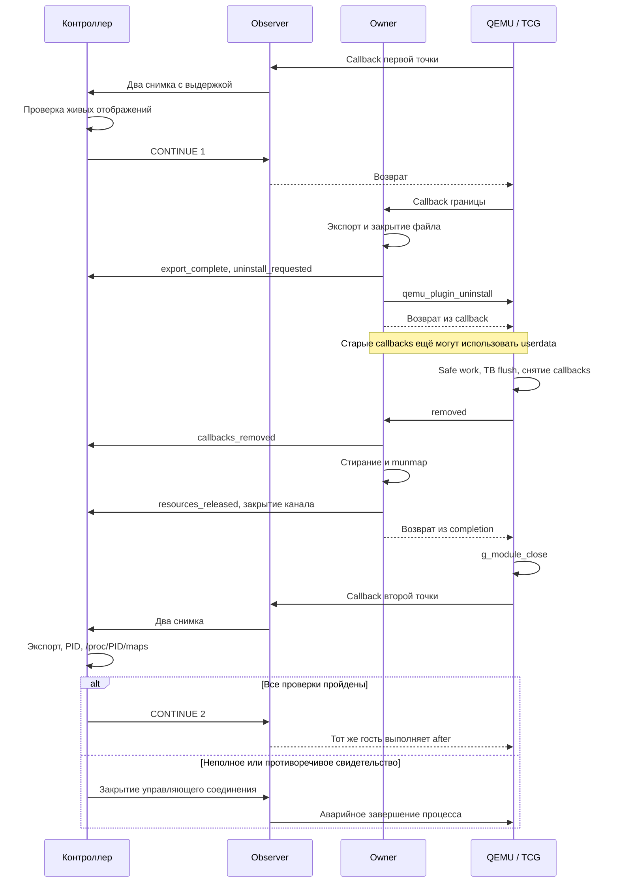

# Execution Capsule: проверка этапов retirement, v1

Этот комплект добавляет внешний контроль экспорта, снятия callbacks,
освобождения выделенной области и исчезновения библиотеки из живого процесса.
Он работает с отдельным тестовым владельцем памяти. Настоящая Phase1 пока
не умеет выполнять этот протокол и **не выгружается**.

Изменения добавляют новый каталог `experiments/execution_capsule_lifecycle`
и этот документ. Исходники и бинарник Phase1, существующие probe, retirement,
containment и unified integration не изменяются.

## 1. Исходная версия и границы результата

База — применённые локальные пакеты probe, unified, retirement, containment
и результаты lifecycle audit. Локальная контрольная ревизия комплекта:
`f75ffe50f7dd8a2972f455532db97d1e7191aeca`. Это служебный снимок интеграции,
а не обязательный commit пользователя. Совместимость определяется SHA-256
входных файлов, а не равенством `HEAD`.

Проверенная GitHub-ревизия `main`:
`3e74e480eea3e945786aa931690609afb81f5f24`. Она не заменяет более новые
локальные компоненты. `BASELINE.json` сохраняет уже известные совместимые
варианты `phase1_runtime.py` и `unified_runtime.py`. Неизвестное изменение
останавливает запуск: перечень допустимых хешей автоматически не расширяется.

Целевая среда: Linux, динамический `qemu-i386` 11.0.1, plugin API 6,
один контролируемый процесс i386 с одним гостевым потоком. Перед запуском
проверяются версия QEMU и соответствие бинарника Phase1 его `.runtime.json`.

Предыдущий VM-аудит Phase1 сообщил `identity: matched` и
`live_retirement_ready: false`. Этот комплект не меняет второй результат.
Наличие `phase1_retired: false` в новом отчёте нормально даже при `passed`.

## 2. Кто участвует

| Элемент | Где работает | Обязанность |
|---|---|---|
| Supervisor Python | Внешний родительский процесс | Собирает комплект, запускает контроллер и QEMU, ждёт завершения, сохраняет итог |
| Контроллер Python | Отдельний дочерний процесс supervisor | Принимает снимки observer, проверяет retirement, разрешает продолжение гостя |
| QEMU linux-user | Отдельный процесс ОС | Выполняет инструкции контрольного i386 ELF через TCG |
| `libcapsule_probe.so`, observer | Внутри QEMU | Читает гостевые регистры/память в допустимом callback, удерживает две контрольные точки |
| `libcapsule_lifecycle.so`, owner | Внутри того же QEMU | Владеет своей областью `mmap`, экспортирует результат, запрашивает собственный uninstall |
| `libtaintforge_ir.so`, Phase1 | Внутри QEMU в двух сценариях | Продолжает обычный анализ; её библиотека должна оставаться загруженной |
| Контрольный `guest.S` | Гостевой контекст i386 | Проверяет регистры, стек, PID, открытый FD и содержимое файла после продолжения |

Плагин — машинный код архитектуры хоста. Даже когда гость i386, его C-плагин
обычно является x86-64 `.so`, если сам QEMU собран для x86-64. Только контрольный
ELF собирается `as --32` и `ld -m elf_i386`.

Имеются два разных Unix-канала:

- Существующий `SOCK_STREAM`: observer → снимки; контроллер → `CHECK` и `CONTINUE`.
- Новый `SOCK_SEQPACKET`: owner → пять сообщений о retirement. По этому каналу
  контроллер **не посылает команд**. Границы пакетов задаёт ядро.

Новый listener создаёт supervisor до `fork` контроллера. Контроллер наследует
listener и делает `accept`. QEMU открывает собственное соединение по пути
в приватном временном каталоге `/tmp/tfl-*`; `close_fds=True` у запуска QEMU
не мешает этому. Принятый сокет существует только у контроллера. Оставшаяся
у supervisor копия listener не удерживает принятое соединение открытым.

## 3. Полный проход на конкретном примере

Пусть запущен сценарий `observer-first`. Адреса точек Python получает через
`nm` из свежесобранного контрольного ELF. Они не зашиты под чужую сборку.

1. QEMU загружает observer и owner. Owner выделяет 4 MiB плюс две защитные
   страницы, заполняет полезную область `0xa7`, обнуляет два счётчика внутри
   неё и передаёт `hello`. Контроллер пока не обязан читать это сообщение:
   небольшой пакет находится в очереди сокета.
2. Гость открывает `capsule-fd.txt` с `O_RDWR | O_CREAT | O_EXCL`, получает FD
   и записывает `before\n`. Смещение в открытом файле равно 7. Он кладёт FD,
   PID, свой ESP и контрольные значения в 32 байта стека.
3. Перед `capsule_point_one` гость имеет EAX=`0x11111111`, ECX=адрес буфера,
   EDX=16, а буфер содержит `0123456789ABCDEF`.
4. Observer вызывается перед инструкцией точки, читает девять регистров,
   16 байт буфера и 32 байта стека. Callback ждёт команд через `poll`.
   Поток хоста спит при отсутствии данных; CPU не занят бесконечным циклом.
5. Python ждёт 200 ms, проверяет, что файл не вырос, посылает `CHECK 1`,
   получает второй одинаковый снимок. Затем `LifecycleGate` принимает
   соединение owner, проверяет PID/UID через `SO_PEERCRED`, идентификатор
   запуска и наличие `.so`, полезной области и guard pages в `/proc/PID/maps`.
6. Python отправляет `CONTINUE 1`. Observer возвращается. Callback owner
   на первой точке создаёт `export.bin`, вызывает `fsync`, закрывает файл,
   передаёт размер и SHA-256, затем сообщает `uninstall_requested`, вызывает
   `qemu_plugin_uninstall(owner, removed)` и **возвращается**.
7. Запрос uninstall ещё не означает завершения. Некоторые уже доступные
   callbacks могут успеть выполниться. Счётчик `pending` отмечает такие вызовы;
   их `userdata` всё ещё указывает на живую область owner.
8. QEMU выполняет отложенную безопасную работу, очищает TCG cache, снимает
   callbacks владельца и вызывает `removed`. В ней owner сообщает
   `callbacks_removed`, стирает свою область, вызывает `munmap`, сбрасывает
   указатели, сообщает `resources_released`, закрывает канал и возвращается.
9. QEMU вызывает `g_module_close`. Только теперь библиотека может исчезнуть
   из отображений процесса. Последнее сообщение и EOF были отправлены раньше.
10. Между точками гость записывает `between\n`; смещение FD становится 15.
    Он заменяет буфер на `fedcba9876543210` и готовит EAX=`0x22222222`.
11. Observer удерживает вторую точку. Python повторяет проверку снимков и
    выполняет `LifecycleGate`: получает оставшиеся события и конец потока,
    читает экспорт, сверяет содержимое, размер и хеш, проверяет отсутствие
    библиотеки owner и её диапазона памяти. Observer и загруженная Phase1
    должны оставаться на месте.
12. Только после успешной проверки Python посылает `CONTINUE 2`. Тот же гость
    проверяет стек и FD, пишет `after\n`, читает обратно все 21 байт, закрывает
    FD и выводит `CAPSULE_OK`. QEMU завершается с кодом 0.

При другом порядке плагинов экспорт и запрос могут произойти до первого
удержания observer. Поэтому первая точка принимает префикс из одного, двух
или трёх событий. Память владельца в первой точке должна оставаться живой.
На второй точке нужны все пять событий и независимые проверки отображений.
В отрицательных сценариях неверный экспорт или преждевременно закрытый поток
могут быть обнаружены уже в первой точке. Suite принимает такой ранний отказ
только с ожидаемой причиной и соответствующим префиксом гостевого файла.



Снимок здесь — диагностическое сообщение, не checkpoint. Python не сохраняет
всю память для восстановления, не запускает второй ELF и не меняет EIP.
Две проверки доказывают свойства контрольного гостя. Они не проверяют все
регистры, FPU/SIMD, GOT/PLT и поведение произвольной динамической программы.

## 4. Почему порядок QEMU принципиален

Разобрана версия `v11.0.1`, commit
`6e9a825c1d4e7b62d072e99a89ecd1a74c7f0d55`, а не `master`.

В `plugins/loader.c` путь live uninstall имеет следующий смысл:

1. `plugin_reset_uninstall` отмечает контекст как `uninstalling`.
2. При существующем `current_cpu` работа ставится через `async_safe_run_on_cpu`.
3. `plugin_flush_destroy` выполняет `tb_flush__exclusive_or_serial`.
4. `plugin_reset_destroy` захватывает `plugin.lock`.
5. `plugin_reset_destroy__locked` снимает callbacks, удаляет контекст из
   реестров, вызывает completion плагина и после её возврата закрывает модуль.

Completion вызывается под `plugin.lock`. Ожидание ответа Python в ней способно
заблокировать продвижение QEMU. Ожидание своего uninstall внутри исходного
vCPU callback также ошибочно: callback должен отпустить выполнение, чтобы
отложенная работа смогла состояться.

В новом owner каждый `send` использует `MSG_DONTWAIT | MSG_NOSIGNAL`. Даже
`EINTR`, переполнение очереди или потеря получателя завершают попытку с кодом
127: повторного бесконечного ожидания нет. В completion нет файлового экспорта,
`fsync`, ожидания команды или `join`. Там остаются обход фиксированных 4 MiB,
`munmap`, два коротких уведомления и `close`. Это ограничение объёма работы,
а не гарантия жёсткого времени исполнения системных вызовов.

Ветвь uninstall без `current_cpu` рассчитана на отсутствие созданных vCPU.
Нельзя использовать её как разрешение вызывать live uninstall из произвольного
потока обслуживания сокета. Этот комплект запрашивает uninstall из vCPU callback.

QEMU во время safe work использует собственную синхронизацию исполнения vCPU.
Она не завершает частные потоки, очереди и обработчики анализатора. У тестового
owner частных потоков нет. Удержание observer само по себе останавливает только
этот гостевой поток; оно не является общей остановкой QEMU и анализатора.

## 5. Протокол и сила каждого свидетельства

Каждый пакет — один UTF-8 JSON размером не более 1024 байт. Конверт имеет ровно
шесть полей: `protocol`, `attempt`, `seq`, `pid`, `event`, `data`.
`protocol=1`; `attempt` — новые 32 шестнадцатеричных символа для каждой попытки;
`seq` начинается с 0. Числовые поля не принимают JSON boolean вместо integer.

| seq / event | Содержимое data | Как проверяется |
|---|---|---|
| 0 / `hello` | Тип владельца, API, адрес/размер `mmap`, размер страницы и полезной области | Ожидаемый тестовый производитель; layout; живые отображения |
| 1 / `export_complete` | Размер и SHA-256 файла | Python сам открывает фиксированный `export.bin`, считает хеш и проверяет известные байты |
| 2 / `uninstall_requested` | Количество execution callbacks на границе | Строгий порядок; положительный счётчик |
| 3 / `callbacks_removed` | Итоговый счётчик и количество pending callbacks | Только после request; разность счётчиков должна совпасть с pending |
| 4 / `resources_released` | Ноль учтённых областей/байт и размер стёртой области | Строгий формат заявления; отдельно проверяется отсутствие диапазона в maps |

`export.bin` содержит ровно:

```text
CAPSULE_EXPORT_V1
attempt=<32 символа идентификатора этой попытки>
```

Последняя строка также заканчивается `\n`. Это тестовый результат, а не dump
гостевой памяти или настоящий отчёт Phase1. Неполный файл после аварии допустим
как диагностический артефакт, но без подтверждённого события он не принимается.
`fsync` файла не означает гарантированную сохранность записи каталога после
сбоя питания: комплект не реализует транзакционное хранилище экспорта.

Python запрещает дубли JSON-ключей, неправильную версию, чужой `attempt`/PID,
перестановку/повтор/пропуск событий, лишние поля, `NaN`, обрезанный и слишком
большой пакет. Пустой пакет без `POLLHUP`/`POLLRDHUP` не считается EOF.
После пятого сообщения требуется завершение потока: фраза «готово» с оставшимся
открытым каналом не принимается. Временной бюджет чтения — абсолютный 1 s на
проверку точки, а не новая секунда после каждого байта или пакета.

Экспорт читается через `O_NOFOLLOW | O_NONBLOCK`; допускается только обычный
файл ожидаемой небольшой длины. FIFO не может повесить проверку. Размер,
mtime/ctime проверяются до и после чтения одного FD. В конце протокола экспорт
проверяется повторно. Это обнаруживает изменения между чтениями, но не делает
файл неизменяемым и не даёт защиты от враждебного процесса с теми же правами.

Четыре результата имеют разную силу:

| Результат | Что установлено | Чего он не доказывает |
|---|---|---|
| Проверенный экспорт | По ожидаемому пути находились правильные байты этой попытки | Полнота настоящего анализа; защита от последующей перезаписи |
| `callbacks_removed_reported` | Принято корректное сообщение producer; в нашем C оно посылается из completion | Независимое перечисление всех callbacks QEMU; остановка потоков Phase1 |
| `resources_released_reported` и отсутствие диапазона | Producer заявил очистку; известная область отсутствует у живого QEMU | Освобождение неизвестных malloc/TLS/GLib-объектов; стирание копий данных |
| `owner_library_absent` | В maps отсутствуют отображения файла с исходными device/inode | Полное удаление всех следов работы; отсутствие копии кода в другом отображении |

Идентичность `.so` запоминается до запуска как `(major, minor, inode)`.
Одного имени файла в `/proc/PID/maps` недостаточно: файл можно переименовать
или удалить. Начало жизни процесса берётся из поля `starttime` в `/proc/PID/stat`
и сверяется при следующих чтениях. Supervisor удерживает дочерний процесс
до `wait`, дополнительно исключая повторное использование его PID в этом окне.

Если освобождённый адрес успела занять другая область, проверка консервативно
откажет. Она не объявляет этот случай успешным освобождением по одному RSS.
Если `g_module_close` не удалит mappings из-за дополнительной ссылки или
`NODELETE`, контроллер также не объявит выгрузку успешной.

`SO_PEERCRED` удостоверяет PID/UID процесса, а не конкретную библиотеку внутри
него. Идентификатор попытки предотвращает случайное смешение запусков, но не
является секретом или MAC. Каналы пригодны для контролируемого ELF и не служат
доверенной границей против вредоносного кода в том же linux-user окружении.

## 6. Что именно происходит с памятью

Owner резервирует `4 MiB + 2 * page_size` через `mmap(PROT_NONE)`. Затем
`mprotect` разрешает чтение/запись только средних 4 MiB. При странице 4096 байт
полное отображение занимает 4 202 496 байт. Первая и последняя страницы — guard
pages без доступа. Первые байты полезной области содержат два `uint64_t`
счётчика, остальное заполнено тестовым значением.

Callbacks получают указатель внутрь этой области как `userdata`. Поэтому её
нельзя освобождать сразу после запроса uninstall. После completion все такие
пользователи в рамках тестового owner уже сняты. Цикл через `volatile unsigned
char *` выполняет записи нулей перед `munmap`, не позволяя компилятору убрать
их как ненужные записи в освобождаемую память. Затем зануляются указатели.

Native harness независимо осматривает все 4 MiB непосредственно перед настоящим
`munmap` и отклоняет ненулевой байт. В VM внешний Python не читает уже снятый
диапазон: он проверяет maps. `zeroed_bytes` в VM остаётся заявлением producer.

`owned_mappings=0` и `owned_bytes=0` относятся к учтённой области данного fixture.
Сокет уведомления, текущий стек completion и код `.so` ещё нужны для возврата;
они не включаются в эту цифру. Временный объект GLib checksum освобождается до
запроса uninstall, но возможные внутренние кеши GLib этим протоколом не измеряются.

Гостевые стек, heap, таблицы GOT/PLT и mappings загруженных гостевых библиотек
этому owner не принадлежат. Он не делает `munmap` по гостевым адресам и не
перезаписывает гостевые регистры. Observer читает их через API QEMU с
`QEMU_PLUGIN_CB_R_REGS`, непосредственно в vCPU callback. Socket-код Python
вообще не вызывает гостевые API QEMU.

Guard pages — средство обнаружения выхода за край; они не отделяют права
анализатора от прав гостя внутри linux-user QEMU. Это один адресный простор
процесса хоста. Новый комплект не устанавливает ограничение RAM для всего QEMU.
В предыдущем containment cgroup `memory.max`/`memory.swap.max` ограничивали
совокупное потребление дерева процессов, а не отдельный heap анализатора.

Стирание одной области и снятие `.so` не очищают автоматически host stack,
освобождённые malloc-чанки, TLS, kernel buffers, file cache, swap, отчёты или
core dump. Сам экспорт намеренно сохраняется. Поэтому `residue_free=false`.
Если нужна граница прав между анализатором и исполнением недоверенного образца,
дальше потребуется отдельный процесс анализатора и защищённый IPC либо иная
архитектура изоляции. Этот эксперимент такой гарантии не вводит.

## 7. Отказы и продолжение

Отказ `LifecycleGate` в любой из двух точек вызывает исключение в контроллере probe.
Тот сохраняет `controller.json` и закрывает управляющее соединение. Observer
обнаруживает потерю контроллера и завершает QEMU с кодом 125. `after` исполняться
не должен. Supervisor проверяет, что не понадобился его аварийный SIGKILL.

Если owner не может послать событие или освободить область, он завершает процесс
с кодом 127 и `LIFECYCLE_ABORT reason=...`. Ложного успешного release нет.
Существующий observer сохраняет собственные абсолютные таймауты: в этой suite
пауза ограничена 5 s, весь процесс — 30 s; supervisor имеет дополнительный запас.
При жёстком `_exit` обычные QEMU/Phase1 atexit-отчёты не гарантируются.

Проверки таймаута/смерти контроллера базового observer уже были пройдены на VM
в предыдущих комплектах. Новый локальный тест непосредственно проверяет разрыв
канала событий и ошибку отправки из completion. Он не заменяет VM-проверку всего
набора потоков QEMU и watchdog.

## 8. Новые файлы и функции

| Файл | Роль в запуске |
|---|---|
| `experiments/execution_capsule_lifecycle/owner.c` | Новый тестовый TCG-плагин, собирается отдельно от Phase1 |
| `experiments/execution_capsule_lifecycle/controller.py` | CLI `audit`/`suite`, строгий протокол, gate, сборка и результат |
| `experiments/execution_capsule_lifecycle/BASELINE.json` | Разрешённые хеши 13 существующих входных файлов |
| `experiments/execution_capsule_lifecycle/tests/host_harness.c` | Native-процесс с моделью расписания QEMU и настоящими mmap/dlopen/socket |
| `experiments/execution_capsule_lifecycle/tests/test_lifecycle.py` | Проверки протокола, отказов и наблюдений живого native-процесса |
| `docs/CAPSULE_LIFECYCLE_EVIDENCE_V1_RU.md` | Этот документ |

В `owner.c`:

- `qemu_plugin_install` проверяет API/архитектуру и пять параметров, соединяется,
  создаёт область, отправляет `hello`, регистрирует init/translation/atexit.
- `init_vcpu` отклоняет второй vCPU. Это ограничение fixture, не механизм
  согласованной остановки многопоточной программы.
- `translate` добавляет счётчик к каждой инструкции и `boundary` к первой точке.
- `count_exec` проверяет живой `userdata` и считает вызовы, включая pending.
- `boundary` экспортирует результат, просит uninstall и сразу возвращается.
- `export_result` создаёт небольшой файл эксклюзивно, закрывает его после `fsync`
  и вычисляет SHA-256 через GLib. Существующие файлы не перезаписываются.
- `removed` получает completion, освобождает только принадлежащую owner область,
  уведомляет Python и возвращает управление загрузчику QEMU.
- `emit` формирует один пакет, делает одну неблокирующую отправку; `close_channel`
  закрывает FD; `fail` завершает весь QEMU при неустранимой ошибке.
- `retained_exit` допускает обычный выход только для намеренного режима keep;
  незавершённый uninstall в нормальном режиме считается ошибкой.

В `controller.py`:

- `Evidence.feed` проверяет очередной пакет и добавляет только принятые события.
  `pairs`, `invalid_constant`, `integer`, `require` задают строгие условия JSON.
- `payload` определяет независимый ожидаемый экспорт для конкретного attempt.
  `verify_export` читает файл; `finish` требует все события, EOF и повторное чтение.
- `receive` применяет лимиты пакета и абсолютный deadline, проверяет закрытие канала.
- `start_time` читает идентичность живого процесса. Разбор учитывает пробелы и
  скобки внутри имени процесса в `/proc/PID/stat`.
- `LifecycleGate.__init__` запоминает идентичности файлов и создаёт listener;
  `__call__` выполняется после удержания observer; `close` закрывает принадлежащие
  контроллеру сокеты. Дополнительный параметр `listener` нужен native-тесту.
- `audit` читает хеши и ничего не устанавливает. `build` переиспользует сборку
  probe/guest, затем собирает новый owner. `suite` соединяет их через существующий
  `probe.run_case`; `main` разбирает только два пользовательских действия.

В harness функции с именами QEMU API моделируют регистрацию, выполнение и
отложенный completion. Команды `boundary`, `complete` и `unload` разделены,
чтобы можно было проверить состояние между completion и реальным `dlclose`.
Подмена `munmap` проверяет нули и затем вызывает настоящий системный вызов.
Подмена `send` позволяет детерминированно получить EAGAIN. Эти функции не
попадают в поставляемую `.so`.

## 9. Установка и запуск на VM

Нужны уже установленные probe и retirement. Lifecycle audit, который запускался
из распакованного предыдущего архива, не обязан быть установлен в репозиторий.
Containment не требуется для этой suite. Произвольный ELF передать нельзя.

Архив содержит `files/` с шестью новыми файлами и patch с теми же байтами.
Изменяемых существующих файлов в patch нет. Применить один раз:

```bash
cd "$HOME/taintforge"
kit_dir="$(mktemp -d)"
unzip "$HOME/Downloads/taintforge_capsule_lifecycle_v1.zip" -d "$kit_dir"
kit="$kit_dir/taintforge_capsule_lifecycle_v1"

(cd "$kit" && sha256sum --check SHA256SUMS) &&
PYTHONPATH="$kit/files:$PWD" python3 -m experiments.execution_capsule_lifecycle.controller audit --repo . &&
git apply --check "$kit/taintforge_capsule_lifecycle_v1.patch" &&
git apply "$kit/taintforge_capsule_lifecycle_v1.patch"
```

Не применять patch повторно поверх собственных правок. При `source_changed`
нужно сравнить изменившийся файл с базой; отключать guard не требуется.

Локальные native-тесты на вашей VM:

```bash
python3 -m unittest experiments.execution_capsule_lifecycle.tests.test_lifecycle -v
```

Это ещё не тест QEMU. Следующая команда запускает семь настоящих QEMU-сценариев:

```bash
lifecycle_out="workdir/capsule-lifecycle-$(date +%Y%m%d-%H%M%S)"
python3 -m experiments.execution_capsule_lifecycle.controller suite \
  --repo . \
  --qemu /usr/bin/qemu-i386 \
  --phase1 build/libtaintforge_ir.so \
  --out "$lifecycle_out"
```

Для одного запуска добавить `--case observer-first` и выбрать новый `--out`.
Каждый запуск требует ещё не существующего выходного каталога.

| Сценарий | Ожидаемый результат |
|---|---|
| `owner-first` | Успех, owner загружен перед observer, QEMU exit 0 |
| `observer-first` | Успех, обратный порядок, QEMU exit 0 |
| `phase1-first` | Phase1 → observer → owner; owner исчезает, Phase1 остаётся, exit 0 |
| `owner-phase1-first` | Owner → Phase1 → observer; те же проверки, exit 0 |
| `keep-control` | Ожидаемый отказ `missing_stage`; QEMU exit 125 |
| `leak-arena` | Ожидаемый отказ `arena_still_mapped` после реального uninstall; exit 125 |
| `bad-export` | Ожидаемый отказ `export_digest`; exit 125 |

У отрицательных сценариев `cases[].status=passed` означает, что отказ корректно
обнаружен и гость не продолжился. Вложенный `run.status=failed` сохраняет исходный
результат старого probe, который для `alone` ожидает exit 0. Это ожидаемо:
новая suite дополнительно требует конкретный отказ, exit 125, завершившийся
контроллер, отсутствие supervisor kill, отсутствие `CAPSULE_OK` и отсутствие
строки `after` в гостевом файле. При отказе в первой точке файл содержит только
`before\n`, во второй — `before\nbetween\n`. Любая другая ошибка не засчитывается
как успех.

Краткий просмотр:

```bash
python3 - "$lifecycle_out/report.json" <<'PY'
import json, sys
report = json.load(open(sys.argv[1]))
print("suite:", report["status"])
for case in report["cases"]:
    run, evidence = case["run"], case["evidence"]
    print(case["case"], case["status"], "exit=", run.get("qemu_exit"),
          "evidence=", evidence.get("status"), "reason=", evidence.get("error", ""))
print("phase1_retired:", report["claims"]["phase1_retired"])
PY
```

В каждом каталоге сценария сохраняются `export.bin`, два `evidence-point-N.json`,
maps для достигнутых проверок памяти, `observations.jsonl`, `controller.json`,
`result.json`, stdout/stderr и `capsule-fd.txt`. В успешной второй точке должны
быть `status=verified`, пять `producer_events`, `stream_closed=true`,
`callbacks_removed_reported=true`, `resources_released_reported=true`,
`owner_library_absent=true`, `arena_range_absent=true`. `observer_present=true`;
`phase1_present=true` только в двух сценариях совместной загрузки.

## 10. Реально выполненные проверки и оставшееся

При подготовке выполнены 14 native-тестов, сборка с предупреждениями как ошибками,
UBSan и GCC static analyzer. Проверены реальные экспортные файлы, peer credentials,
доставка пакетов, `mmap/mprotect/munmap`, нули перед unmap, `dlopen/dlclose`, чтение
maps живого процесса, порядок/типы/идентичность событий, отсутствие EOF, таймаут,
разрыв канала, EAGAIN при completion, сохранённый модуль, утечка области и ложный хеш.

Среда подготовки не допускает именованные Unix-сокеты и виртуализирует PID
не так, как доступный `/proc`. Поэтому native-тесты запускались с явно включёнными
**тестовыми** адаптерами: socketpair создаётся в дочернем процессе и передаётся
через SCM_RIGHTS, а чтение `/proc` адресуется по proc-PID именно этого дочернего
процесса. Содержимое maps, credential checks, `munmap` и `dlclose` остаются
настоящими. Эти адаптеры не используются CLI suite и не нужны на Arch VM.
Полные команды, результаты и ограничения сохранены в `LOCAL_VALIDATION.json`
и `validation/` внутри архива.

На VM остаются обычный bind/connect именованного сокета, настоящий TCG,
safe-work/TB flush/uninstall QEMU 11.0.1, совместная загрузка с текущей Phase1,
новая обработка отказов через observer/watchdog и сохранность гостевого состояния
в семи сценариях новой suite. QEMU в среде подготовки отсутствует; эти проверки
не помечены как выполненные. Более ранние успешные VM-логи относятся к предыдущим
комплектам, а не автоматически к новому owner.

## 11. Как подключать настоящую Phase1 после её исправлений

Нельзя просто заменить имя `.so` в этой suite и объявить задачу решённой.
Контракт fixture специально требует `producer=capsule-fixture-v1` и известный
маленький экспорт. Для реального анализатора нужно согласовать его build identity,
перечень артефактов, владельцев памяти и критерии завершённости каждого этапа.

Дальнейшая последовательность:

1. Проверить новый исходный код и `.runtime.json`, включая исправления lifecycle
   audit. Обычные исправления финального cleanup ещё не дают live retirement.
2. Ввести состояние quiescing: запретить новые задания анализа и модификацию
   экспортируемых структур; завершить собственные workers вне completion и без
   циклических ожиданий QEMU. Определить, что делают уже зарегистрированные
   callbacks в этом состоянии. В fixture они ещё считают вызовы; это не готовая
   политика для настоящего экспортера.
3. В допустимом vCPU-контексте дочитать необходимые гостевые данные и полностью
   сформировать экспорт. Нельзя переносить чтение гостя в socket thread или
   рассчитывать на него в completion после снятия callbacks.
4. Из поддержанного контекста запросить uninstall и вернуть управление QEMU.
   Сохранить всё, что могут использовать оставшиеся callbacks, до completion.
5. В completion вызвать единственный согласованный путь уничтожения собственных
   ресурсов. Учесть страницы, bitmap, графы, очереди, строки, TLS и заимствованные
   указатели; исключить повторный cleanup. Не ждать контроллер или workers здесь.
6. Передать отдельные сообщения экспорта, callback completion и очистки с
   настоящим учётом ресурсов. Внешне проверить доступные измеряемые объекты,
   исчезновение исходной библиотеки и продолжение того же гостя.

OEP требует отдельного решения. Если анализатор выбрал адрес задним числом,
нельзя присвоить EIP этому адресу и сохранить уже изменённые память/FD/состояние
процесса как будто исполнения не было. Текущий эксперимент гарантирует только
проверку между двумя известными точками контрольного ELF. В нём допустимо
выполнение гостевых инструкций после запроса и до завершения uninstall.

Длинная остановка с Python-командой и диагностические снимки нужны проверочному
комплекту. Они не объявлены обязательным механизмом production retirement.

Версионные первоисточники:

- [QEMU v11.0.1, loader.c](https://github.com/qemu/qemu/blob/v11.0.1/plugins/loader.c)
- [QEMU v11.0.1, plugin API](https://github.com/qemu/qemu/blob/v11.0.1/include/plugins/qemu-plugin.h)
- [QEMU v11.0.1, API implementation](https://github.com/qemu/qemu/blob/v11.0.1/plugins/api.c)
- [QEMU v11.0.1, TCG plugin documentation](https://github.com/qemu/qemu/blob/v11.0.1/docs/devel/tcg-plugins.rst)
