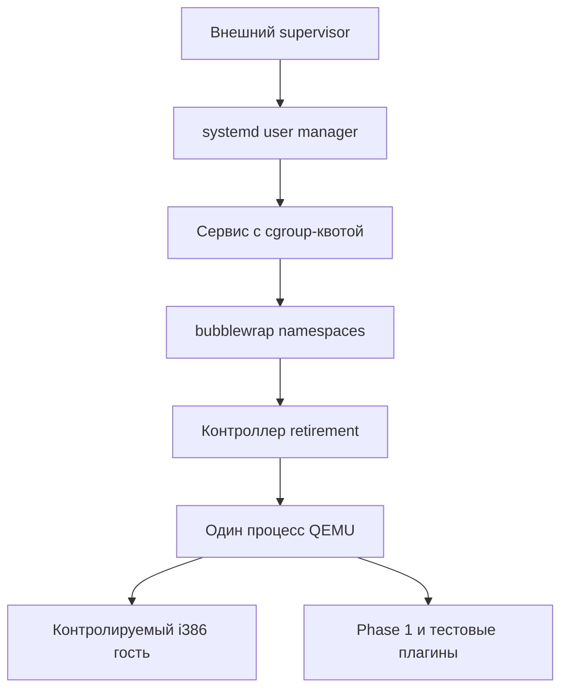

**Execution Capsule: внешний контур ограничения памяти и ресурсов, v1**

Этот шаг добавляет проверяемое Linux-окружение вокруг прежнего эксперимента
retirement. Он не переносит настоящий анпакер в отдельный процесс и не объявляет
malware безопасным для запуска. Вход по-прежнему только известный `guest.S`.
Произвольного `--binary` или запуска пользовательской команды здесь нет.

Новая рабочая логика находится в одном Python-файле. Существующие C-плагины,
контроллеры, гостевой ELF, production unified runner и файлы фазы 1 не изменены.

**Зачем нужен этот шаг.** В предыдущем комплекте проверялось, что тестовый плагин
может запросить отключение, дождаться подтверждения QEMU, обнулить собственные
4 МиБ, сделать `munmap()` и выгрузиться, сохранив исполняющийся гостевой процесс.
Это проверка жизненного цикла памяти конкретного владельца. Она не ограничивает
общий расход RAM и не отделяет native-плагин от остальных частей QEMU.

У выбранного `qemu-i386` гостевые отображения, код QEMU, TCG и оба native-плагина
находятся в одном host-процессе. Права страниц полезны для обнаружения ошибок,
но не образуют границу доверия между native-компонентами этого процесса.
В документации именно [QEMU v11.0.1](https://github.com/qemu/qemu/blob/v11.0.1/docs/system/security.rst)
TCG относится к режиму, на который нельзя возлагать гарантии гостевой изоляции.
Нельзя исправить это одним вызовом `mprotect()` в новом плагине.

Поэтому добавляется внешняя граница Linux: собственный сервис с квотой cgroup,
пространства имён и ограниченный набор доступных файлов. Она дополняет прежний
retirement, а не превращает его в доказательство полной очистки анпакера.

**План и выполненные изменения.**

| Шаг | Реализация | Критерий |
|---|---|---|
| Проверить исходную версию | 13 файлов сверяются с допустимыми SHA-256 | Неизвестная редакция останавливает запуск |
| Ограничить память до гостевого запуска | Transient service `systemd --user` | Чтение фактических `memory.max`, `memory.swap.max`, `memory.oom.group`, `pids.max` |
| Ограничить доступ к хосту | `bubblewrap` с обязательными user/mount/PID/net/IPC/UTS namespaces | Отличающиеся namespace ID, read-only mounts, отсутствие host-canary |
| Проверить срабатывание лимита | Режим `oom-check` | Маркер начала нагрузки + `Result=oom-kill` от systemd |
| Проверить прежний эксперимент внутри контура | Режим `suite` | Старый retirement report целиком passed |
| Проверить завершение | Остановка только своего случайно названного сервиса | Сервис не активен; существующая cgroup не содержит процессов |

**Состав файлов.**

| Новый файл в репозитории | Назначение |
|---|---|
| `experiments/execution_capsule_contain/controller.py` | Внешний supervisor, сборка команды сервиса, вход в sandbox, проверка защиты и три режима испытания |
| `experiments/execution_capsule_contain/BASELINE.json` | Допустимые хеши входных файлов предыдущих пакетов; сам по себе ничего не устанавливает |
| `experiments/execution_capsule_contain/tests/test_containment.py` | Host-проверки принятия/отклонения свидетельств, условий запуска, таймаута и очистки |
| `docs/EXECUTION_CAPSULE_CONTAINMENT_V1.md` | Этот документ |

В поставке дополнительно есть `apply.py`, `MANIFEST.json`, обычный `.patch`,
`README_RU.md`, `LOCAL_VALIDATION.json`, `validation/` и `SHA256SUMS`.
Это средства доставки и результаты проверки, они не являются частью runtime.
`apply.py` проверяет известную базу, не перезаписывает неизвестные правки,
сохраняет backup и откатывает свои записи при обычной ошибке установки.
Пакет добавляет четыре файла, не заменяя существующие. Защита от потери питания
во время всей серии записей не заявляется. Повторное применение идемпотентно.

Предыдущий `taintforge_capsule_retirement_v1` должен быть установлен. Поддержаны
обе его базы: исходный standalone probe и capsule-unified. Для `Phase1Runtime`
допускаются две ранее проверенные редакции, включая хеш из лога пользователя.
Commit GitHub `3e74e480…` остаётся справочной точкой; он не подменяет актуальные
локальные пакеты. Локальный commit `cf70506` — только снимок базы разработки,
его наличие в пользовательском репозитории не требуется.

**Где находятся процессы.**



Внешний supervisor не входит в cgroup создаваемого сервиса. Внутри лимита
находятся bubblewrap, Python-контроллеры, процессы сборки и QEMU со всеми его
потоками и плагинами. Внутренний контроллер может погибнуть при OOM вместе с
QEMU; внешний supervisor остаётся для получения результата systemd.
Это не гарантия выживания при глобальном OOM хоста или смерти всей VM.

Процесс QEMU один: между точками наблюдения он не пересоздаётся. Поскольку
включено отдельное PID namespace, `host_pid` в старых snapshots теперь означает
PID QEMU **внутри этого namespace**. Внутренний `Popen.pid`, `/proc/PID/maps` и
плагин видят одну систему PID; сравнение остаётся корректным. Новое свидетельство
помечено `pid_scope=bubblewrap_pid_namespace`. С PID внешнего терминала это
число сравнивать нельзя.

**Функции Python по порядку работы.**

| Функция | Что именно делает |
|---|---|
| `main()` | Разбирает `check`, `oom-check`, `suite`; внутренние `_enter`/`_inside` используются только этапами собственного запуска |
| `supervise(args)` | Создаёт новый output, вызывает подготовку, запускает transient service, ждёт с внешним deadline, проверяет результат, останавливает сервис и записывает итог |
| `prepare(args, out)` | Отвергает root и неизвестные исходники; проверяет инструменты/user manager; копирует только 13 разрешённых файлов; для suite проверяет и копирует выбранный `.so` с manifest |
| `systemd_command(config, script)` | Возвращает список argv с лимитами; команды shell не строит; включает `env -i` и Python `-I -B` для внутренних стадий |
| `enter(config)` | Уже внутри сервиса читает cgroup membership и лимиты, сохраняет `entry.json`, затем заменяет себя через `exec` на bubblewrap |
| `bubblewrap_command(config, directory)` | Формирует обязательные namespaces, read-only системные/входные mounts и единственный writable bind `/out` |
| `inside(config)` | Сначала проверяет защиту; затем заканчивает `check`, запускает ограниченную memory pressure либо вызывает прежний `retirement.suite()` |
| `inspect_inside(config)` | Сверяет namespace ID, cgroup, capabilities, NNP, core limits/filter, read-only mounts, невидимость хостовых путей и отсутствие внешних сетевых интерфейсов; пробует запрещённые операции |
| `membership(text)` | Принимает только одну строку unified cgroup v2 с отдельной группой; отвергает root cgroup, legacy и `..` |
| `limits(directory, config)` | Читает четыре kernel-файла и требует точного совпадения с запрошенной политикой; `max` вместо числа является ошибкой |
| `namespaces()` | Читает ссылки `/proc/self/ns/{user,mnt,pid,net,ipc,uts}` |
| `unit_status(unit)` | Читает состояние именно своего сервиса через systemd; его `Result` нужен для независимой классификации OOM |
| `verify(config, exit_code, status)` | Повторно проверяет сохранённое свидетельство, nonce, лимиты и ограничения утверждений; для suite проверяет прежний report и идентичность QEMU; для OOM требует подтверждение менеджера |
| `run(*argv)` | Ограниченный по времени запуск вспомогательной команды с закрытым stdin и проверкой кода завершения |
| `digest(path)` | Потоковый SHA-256 входного файла |
| `write_json(path, value)` | Запись во временный соседний файл, flush/fsync и атомарная замена одного JSON |
| `read_json(path)` | Ограниченное чтение не более 1 МиБ; отвергает symlink/FIFO и не блокируется на FIFO; это не аутентифицированный канал от гостя |
| `require(condition, message)` | При ложном условии выбрасывает исключение; ветки продолжения без защиты нет |

Разделение на `_enter` и `_inside` необходимо: сначала systemd применяет квоту,
затем bubblewrap создаёт namespaces, и только после проверки получившегося
окружения вызывается suite. Внутренний Python запускается в isolated mode.
Для импорта существующего кода suite он явно добавляет только `/repo`.

**Что доступно из sandbox.**

| Путь внутри | Источник | Доступ |
|---|---|---|
| `/usr` | Системный runtime и инструменты сборки хоста | Read-only; это весь `/usr`, не индивидуальная allowlist библиотек |
| `/bin`, `/sbin`, `/lib`, `/lib64` | Системные ссылки в `/usr` либо соответствующие каталоги | Read-only либо ссылки на read-only дерево |
| `/etc/ld.so.cache` | Только cache динамического загрузчика, если существует | Read-only |
| `/repo` | Свежая копия разрешённых исходников и runtime | Read-only; рабочий checkout целиком не монтируется |
| `/out` | Новый `OUT/data` | Writable; единственный writable bind к файловой системе хоста |
| `/cgroup` | Каталог собственной cgroup сервиса | Read-only для проверки; изменить свои лимиты через него нельзя |
| `/tmp` | Новый tmpfs | Writable, исчезает с namespace |
| `/proc` | Procfs для нового PID namespace | Видны процессы sandbox |
| `/dev` | Минимальный набор, создаваемый bubblewrap | Не bind всего `/dev` хоста |
| `/run` | Новый пустой каталог | Без сокетов пользовательской сессии |

Домашний каталог и исходный workdir не монтируются. Отдельный host-canary
создаётся снаружи: внутри его путь должен отсутствовать, снаружи содержимое
после запуска должно остаться прежним. Это конкретная отрицательная проверка,
а не доказательство отсутствия любого возможного пути выхода через ядро.
Стандартные потоки сервиса направлены в `service.log`, stdin — `/dev/null`.
Преднамеренно сохранённые результаты и журналы не удаляются.

**Как именно ограничивается память.**

По умолчанию `--memory-mib 1024` задаёт `MemoryMax=1073741824` в сервисе.
Systemd применяет это к `memory.max` cgroup v2. До гостевого запуска контроллер
читает этот файл и требует именно `1073741824`, а не `max`. Допустимый диапазон
настройки обычного запуска — 256–4096 МиБ.

`MemorySwapMax=0` требует `memory.swap.max=0`. `OOMPolicy=kill` заставляет systemd
установить `memory.oom.group=1`, что также проверяется чтением. Отдельной
выдуманной настройки `MemoryOOMGroup=` в команде нет. `TasksMax=64` проверяется
как `pids.max=64`; это лимит задач, включающий потоки, а не только процессов.

Когда учтённая память достигает `memory.max`, ядро пытается её освободить; если
это невозможно, может сработать OOM killer внутри группы. Linux допускает
временное превышение и разные результаты отдельных видов выделения памяти.
Это не постоянное опрашивание RSS Python-скриптом и не `RLIMIT_AS`, который
мог бы мешать виртуальным резервам QEMU. [Механизм cgroup v2](https://docs.kernel.org/admin-guide/cgroup-v2.html).

Квота охватывает учитываемую cgroup память всего сервиса. Она **не** означает:

- отдельный лимит 1024 МиБ только для гостевых `malloc`;
- две раздельные квоты для гостя и анпакера;
- точную сумму RSS всех процессов: общие file-backed страницы и page cache
  учитываются по правилам ядра, включая первое начисление группе;
- отдельные физические, зашифрованные или закреплённые в RAM страницы;
- отсутствие копий данных в старых файлах, уже существовавшем swap или дампах.

В этом комплекте нет `mlock`, аппаратного enclave, очистки физических страниц,
запрета hibernation хоста или защищённого от host-root хранилища. `MemorySwapMax=0`
ограничивает использование swap данной группой, но не является сертификатом
отсутствия всех внешних копий данных.

**Core dump и повышение привилегий.**

Сервис получает `LimitCORE=0`, `CoredumpFilter=0x0`, `NoNewPrivileges=yes`.
Bubblewrap сбрасывает capabilities и не даёт создавать вложенные user namespaces.
Перед workload проверяются оба core rlimit, пустой mapping filter, NNP=1 и нули
в CapInh/CapPrm/CapEff/CapBnd/CapAmb. Дополнительно выполняется `unshare --user -- true`:
успех этой команды означает провал admission.

`RLIMIT_CORE` может игнорироваться ядром при piped core handler. Пустой filter
не означает, что не останется метаданных дампа; QEMU также имеет собственную
логику гостевых core. Поэтому `complete_core_dump_prevention=false` остаётся
явным ограничением. Поле `core_pattern` сохраняет фактическую конфигурацию,
глобальный sysctl пользователя не меняется. [Правила core dump Linux](https://man7.org/linux/man-pages/man5/core.5.html).

Собственная seccomp allowlist не устанавливается: `seccomp_policy_installed=false`.
Профиль ограничивает окружение контролируемого ELF, но ещё не сертифицирован
для произвольных враждебных образцов. Наличие namespaces нельзя выдавать за
полную изоляцию от ошибок общего ядра.

**Реальный пример запуска и наблюдений.**

Команда `suite --case observer-first` создаёт сервис, проверяет окружение и
вызывает прежнюю `retirement.suite()` с путями `/repo` и `/out/retirement`.
Она собирает прежние `guest.S`, `probe.c` и `retire.c`, извлекает адреса символов
через `nm` и запускает выбранный динамический `/usr/bin/qemu-i386` 11.0.1/API 6.
Адреса не зашиты в новый wrapper. Типичный предыдущий build давал точки
`0x080490b9` и `0x080491ba`, но контроллер каждый раз получает их из своего ELF.

В `observer-first` загружены observer и тестовый владелец области; в
`phase1-first` дополнительно загружена настоящая Phase 1. Даже для варианта
`observer-first` прежняя suite проверяет выбранную Phase 1 и её runtime manifest.

1. Гость открывает файл, пишет `before`, сохраняет FD/PID/ESP и stack canaries.
2. В точке 1 callback observer читает девять регистров: eax, ebx, ecx, edx,
   esi, edi, ebp, esp, eip. Затем читает известные 16 байт буфера и 32 байта стека.
   Чтение выполняется прежним C-плагином в допустимом vCPU callback QEMU.
3. Python получает snapshot по AF_UNIX внутри sandbox. После удержания и CHECK
   получает повторный snapshot. Ожидаются EAX=`0x11111111` и `0123456789ABCDEF`.
4. Тестовый retirement plugin запрашивает uninstall. После возврата callbacks
   QEMU выполняет safe work; подтверждение позволяет обнулить и снять его
   собственные 4 МиБ. Нельзя ждать подтверждения, заблокировав тот же callback.
5. После CONTINUE 1 гость пишет `between` и сам меняет буфер.
6. В точке 2 ожидаются EAX=`0x22222222`, буфер `fedcba9876543210`, прежние PID/ESP
   и корректный стек. Внешний относительно QEMU, но внутренний относительно
   sandbox Python читает `/proc/PID/maps`: область и тестовая `.so` должны исчезнуть.
7. CONTINUE 2 позволяет гостю проверить файловую позицию, дописать `after`,
   прочитать/сравнить 21 байт, закрыть FD, вернуть управление через сохранённый
   стек и вывести `CAPSULE_OK`.
8. После конца сервиса внешний supervisor проверяет результат и его остановку.

Результат FD oracle: ровно `before\nbetween\nafter\n`. Сам новый wrapper не
читает guest registers/memory и не меняет буфер. Он не добавляет socket thread
с произвольными вызовами QEMU API. Пауза observer всё ещё означает удержание
одного vCPU; общей остановки анализатора или атомарного переключения на OEP нет.

**Установка и запуск на VM.**

Нужны рабочий `systemd --user`, cgroup v2 с memory/pids controllers, разрешённые
unprivileged user namespaces, bubblewrap с `--disable-userns` и
`--assert-userns-disabled`, Python и прежняя сборочная среда probe.
Версии systemd/bubblewrap записываются в конфигурацию. Неподдерживаемое свойство
systemd или запрещённый namespace приводят к ошибке без незащищённого fallback.
Проверка доступных флагов не заменяет фактическую VM-приёмку.

```bash
cd "$HOME/taintforge"

containment_kit_dir="$(mktemp -d)"
unzip "$HOME/Downloads/taintforge_capsule_containment_v1.zip" \
  -d "$containment_kit_dir"

python3 "$containment_kit_dir/taintforge_capsule_containment_v1/apply.py" \
  --repo . --check
python3 "$containment_kit_dir/taintforge_capsule_containment_v1/apply.py" \
  --repo . --apply
```

Если guard сообщает об отсутствии `execution_capsule_retire`, сначала применить
предыдущий retirement v1. Если он сообщает неизвестный хеш — сверить новую
локальную редакцию; не исправлять хеши вслепую ради пропуска проверки.
Обычный patch — альтернатива установщику, его не нужно накладывать второй раз.

Все следующие команды выполняются **без sudo**. Сам wrapper не устанавливает
пакеты и не меняет системные настройки. Если `bwrap` отсутствует, установить
пакет `bubblewrap` обычным для своей согласованной Arch-системы способом; ранее
возникший конфликт версий GCC не нужно решать заменой отдельных библиотек здесь.

```bash
containment_out="workdir/capsule-containment-$(date +%Y%m%d-%H%M%S)"

# Только проверка окружения, без QEMU и без memory pressure.
python3 -m experiments.execution_capsule_contain.controller check \
  --repo . --out "$containment_out/check" &&

# Намеренное исчерпание памяти отдельного сервиса: quota 128 МиБ.
python3 -m experiments.execution_capsule_contain.controller oom-check \
  --repo . --out "$containment_out/oom" &&

# Сначала один положительный сценарий внутри проверяемого контура.
python3 -m experiments.execution_capsule_contain.controller suite \
  --repo . --phase1 build/libtaintforge_ir.so \
  --case observer-first --memory-mib 1024 --out "$containment_out/one" &&

# Затем все 11 сценариев retirement, включая совместную загрузку и отказы.
python3 -m experiments.execution_capsule_contain.controller suite \
  --repo . --phase1 build/libtaintforge_ir.so \
  --memory-mib 1024 --out "$containment_out/all"
```

Успешный `oom-check` возвращает 0 во внешнем CLI и `status=passed`, хотя сервис
внутри намеренно погибает с ненулевым кодом. Тест ограничен попыткой выделить
256 МиБ при подтверждённой квоте 128 МиБ: 64 anonymous private mmap по 4 МиБ,
касание каждой страницы, сохранение всех mapping до OOM. К одному виртуальному
резервированию проверка не сводится. Обычный SIGKILL, таймаут или Python
MemoryError не засчитываются как подтверждённый OOM.

Положительная suite должна сохранить прежние регистры/стек/FD и дать passed
для всех сценариев. Для `keep-control` сохранённая область и `.so` — ожидаемый
контрольный результат, не ошибка очистки. Квота действует и в этом случае.

```bash
python3 - "$containment_out/all/report.json" <<'PY'
import json, sys
r = json.load(open(sys.argv[1]))
print("status:", r["status"])
print("unit_stopped:", r.get("unit_stopped"))
print("limits:", r.get("containment", {}).get("limits"))
print("error:", r.get("error", r.get("cleanup_error", "")))
PY

cat "$containment_out/one/data/retirement/observer-first/stdout.log"
cat "$containment_out/one/data/retirement/observer-first/capsule-fd.txt"
```

**Артефакты запуска.**

| Путь относительно OUT | Содержимое |
|---|---|
| `report.json` | Итог внешнего supervisor, запрошенная политика, статус сервиса и границы гарантий |
| `command.json` | Точный argv systemd-run |
| `service.log` | Диагностика входа, сборки и запуска; смотреть первой при ошибке |
| `inputs/config.json` | Неизменяемая внутри sandbox конфигурация и хеши исходной базы |
| `inputs/...` | Копии разрешённых входов; оригинальные исходники сюда не монтируются |
| `host-only-canary` | Безобидный маркер проверки невидимости/сохранности хостового пути |
| `data/entry.json` | Cgroup и её лимиты до bubblewrap |
| `data/containment.json` | Фактическая проверка внутри namespaces до workload |
| `data/pressure.json` | Только oom-check: маркер начала ограниченной нагрузки |
| `data/retirement/report.json` | Итог прежней suite внутри sandbox |
| `data/retirement/CASE/...` | Старые snapshots, maps, lifecycle journal, результаты и файлы FD oracle |

Относительные к sandbox абсолютные пути `/out/...` в Phase 1 manifest отражают
реальные пути исполнения. Снаружи соответствующие байты лежат в `OUT/data/...`.
Manifest не переписывается после запуска: это сохранило бы красивый путь ценой
изменения свидетельства. Изменять пути нужно при интерпретации отчёта.

**Отказы и очистка.**

Нет user manager, неизвестная база, недоступный namespace или неверный kernel
limit — гостевой workload не запускается. Если service упал, вывод остаётся в
`service.log`; ошибка не вызывает запуск suite непосредственно на хосте.
У самого сервиса есть `RuntimeMaxSec`: 60 секунд для check/OOM и 600 для suite.
Внешний deadline даёт ещё 20 секунд на завершение менеджером.

В блоке finally supervisor останавливает только свой сервис с UUID. Настройка
`KillMode=control-group` и `TimeoutStopSec=5s` ограничивает уборку потомков.
Подтверждаются неактивное состояние и, если каталог cgroup ещё существует,
`populated 0`. Неподтверждённая уборка меняет даже прежний passed на failed.
Затем сбрасывается failed-состояние только этой transient unit. Журналы сохраняются.

SIGKILL самого внешнего supervisor не исполняет его finally. В этом случае
немедленная остановка им не гарантируется; действует deadline systemd.
`--die-with-parent` bubblewrap не превращает user manager в ребёнка supervisor.
Отдельный SIGKILL внутреннего socket controller по-прежнему проверяется старой
suite: C-plugin обнаруживает потерю соединения и завершает QEMU. Эти два случая
нельзя смешивать. Ожидание одного гостевого потока не означает quiescence всех
потоков QEMU.

**Что действительно проверено здесь.**

- 17 новых host-тестов: отказные условия, разбор cgroup, kernel-readback на
  файловой модели, свидетельства, OOM classification, дедлайн, остановка и
  отсутствие fallback. Привилегированные операции в них моделируются.
- 11 прежних retirement host-тестов на новой базе с настоящими dlopen/dlclose,
  mmap/munmap и моделью QEMU callbacks. Это не запуск QEMU.
- Проверки установочного комплекта, защищённых файлов и патча перечислены в
  `LOCAL_VALIDATION.json`; журналы приложены.
- Реальный CLI в среде разработки отверг запуск от root. Отдельная попытка
  bubblewrap завершилась EPERM при создании NETLINK_ROUTE socket. Ограничение
  среды не обходилось. cgroup смонтирована read-only; `qemu-i386` и pkg-config
  здесь отсутствуют. Реальный новый sandbox/pressure/QEMU E2E не выполнялся.

На VM остаются все четыре команды приёмки выше. Ранее предоставленные
пользователем 12/12 для исходного probe доказывают его работу в прежнем окружении,
но не являются результатом этого нового контура или retirement под ним.

Повторить новые host-тесты после установки можно без systemd-сервиса и QEMU:

```bash
python3 -m unittest discover -s experiments/execution_capsule_contain/tests -v
```

Их успех подтверждает логику проверок и обработки ошибок, а не реальную
настройку kernel isolation. Для последней предназначены команды VM-приёмки.

**Что остаётся до целевой архитектуры.**

`phase1_memory_released=false`: настоящий `libtaintforge_ir.so` остаётся загружен.
`guest_analyzer_memory_separated=false`: QEMU и native-анализатор всё ещё делят
адресное пространство. `residue_free=false`: нет проверки и очистки всех копий.
`evidence_channel_protected_from_guest=false`: записи внутри `/out` доступны
исполняющемуся контролируемому окружению; их хеши не являются аутентификацией
против произвольного враждебного процесса. `hostile_sample_ready=false`.

Следующий переход требует согласования с разработчиком фазы 1:

1. Описать владельцев GLib-таблиц, DCFG/DTA/DSE/trace/aux buffers, Capstone,
   потоков, FD, экспортов и callback userdata. У каждой allocation должен быть
   проверяемый владелец и конкретное завершение жизненного цикла.
2. Ввести cooperative export/quiesce/release для Phase 1. Uninstall API удаляет
   и exit callback; нельзя рассчитывать на позднюю очистку только в atexit.
3. Для настоящего разделения памяти вынести крупное состояние анализа в отдельный
   процесс с ограниченным протоколом. Небольшой QEMU-side adapter останется частью
   доверенной базы, с guest reads в допустимых callbacks. Это потребует изменений
   интеграции Phase 1, которые этот комплект намеренно не делает за её владельца.
4. Согласовать внешнюю границу исполнения враждебных образцов: отдельная VM с
   подходящим механизмом виртуализации либо дополнительно проверенный OS sandbox,
   профиль syscall и защищённый канал свидетельств. TCG сам такой границей не станет.
5. Сформулировать ограниченное утверждение об очистке: какие live allocations
   уничтожены, какие данные специально экспортированы и где ещё возможны копии.
   «Все следы удалены» без этого перечня непроверяемо. Журналы анализа сохраняются.

Этот этап не добавляет checkpoint, восстановление гостя, fuzzing или RSP.

**Источники для перепроверки механизма.**

- [QEMU v11.0.1: security model](https://github.com/qemu/qemu/blob/v11.0.1/docs/system/security.rst) — почему TCG нельзя считать границей безопасности.
- [QEMU v11.0.1: plugin loader](https://github.com/qemu/qemu/blob/v11.0.1/plugins/loader.c) — прежняя последовательность удаления callbacks, completion и закрытия `.so`.
- [Linux: cgroup v2](https://docs.kernel.org/admin-guide/cgroup-v2.html) — memory/pids accounting и OOM.
- [systemd v256: OOMPolicy](https://github.com/systemd/systemd/blob/v256/man/systemd.service.xml) — установка `memory.oom.group` политикой kill.
- [systemd-run](https://man7.org/linux/man-pages/man1/systemd-run.1.html) — `--wait`, `--pipe`, сохранение failed units без `--collect`.
- [bubblewrap v0.9.0 manual](https://github.com/containers/bubblewrap/blob/v0.9.0/bwrap.xml) — обязательные namespaces, disable-userns и mounts; фактическая версия пользователя записывается при запуске.
