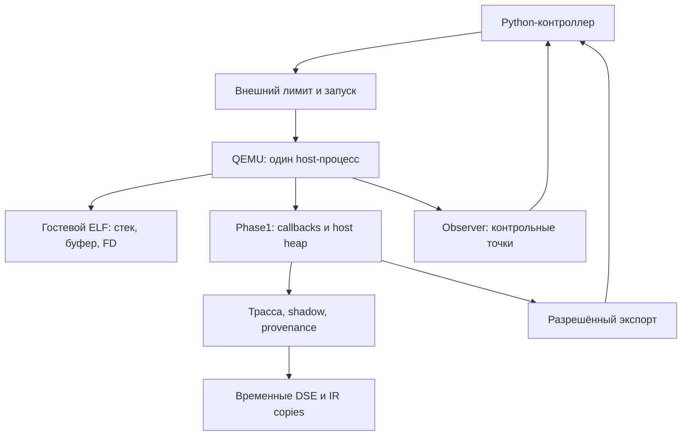
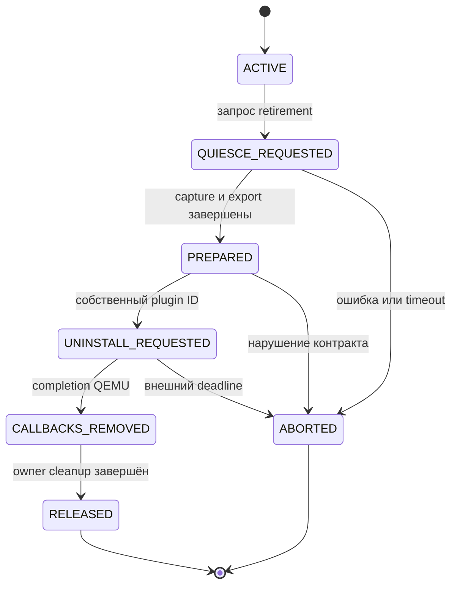

# TaintForge: аудит владения памятью Phase1 и контракт отключения, v1

Дата: 24 сентября 2026. Целевая среда: Linux user-mode, i386, один гостевой процесс и один гостевой поток, динамический QEMU 11.0.1, plugin API 6.

## 1. Что сделано на этом этапе

Подготовлен адресный статический аудит настоящего Phase1: карта 26 семейств ресурсов, восемь замечаний к жизненному циклу, последовательность безопасного отключения и исполняемая проверка идентичности исходников/сборки. Патч добавляет четыре файла. Существующие Phase1, probe, retirement, containment и unified runtime не меняются.

**Реальное отключение Phase1 и очистка его памяти пока не реализованы.** Здесь нет скрытого вызова `plugin_exit()`, новой загрузки `.so` или автоматической пересборки. Это подготовка конкретного изменения для разработчика Phase1, с проверкой того, к какой версии применимы выводы.

Результат аудита — не доказательство отсутствия всех утечек. Проверены основные владельцы, цепочки уничтожения, связи callbacks и экспорт; не доказаны все пути каждой аллокации, состояние внутренних allocator/caches сторонних библиотек и поведение реального бинарника на VM.

## 2. На какой версии основаны выводы

Предыдущая локальная копия исходников была неполной: рецепт называл 22 C-файла, присутствовали девять. Для аудита отдельно получен полный набор Phase1 из `TaintForge-IoT/TaintForge-IoT`, commit:

```text
3e74e480eea3e945786aa931690609afb81f5f24
```

Этот commit был текущим `main` при проверке. Его родитель — `8d48587843dd30ba5ac97e2bb25f6d5c1801a2cb`, встречавшийся в твоём логе. Однако совпадение commit или файлов Python-интеграции не устанавливает происхождение установленного плагина.

В точном рецепте `unpacker/test/build_group7_4c1_plugin.sh` выбран следующий набор:

| Группа | Компилируемые C-файлы |
|---|---|
| Сбор исполнения | `qemu_unpacker.c`, `dta.c`, `provenance.c`, `dcfg.c`, `trace.c`, `aux_trace.c` |
| Зависимости и replay | `trace_deps.c`, `trace_deps_x86.c`, `replay_input.c`, `replay_sources.c` |
| DSE | `dse.c`, `dse_lift_x86.c` |
| IR | `ir.c`, `ir_eval.c`, `ir_opt.c`, `ir_lift_x86.c`, `ir_replay.c`, `ir_inputs.c`, `ir_runtime.c`, `ir_ssa.c`, `ir_smt.c`, `ir_branches.c` |
| Контракты и вывод | `runtime_diag.c`, `qemu_flags_contract.c`, `elf_image.c`, `phase1_io.c` |

Итого: **26 C-файлов, 26 заголовков, shell-рецепт и `phase1_build_manifest.py` — 54 входных файла**. Все полученные байты проверены по Git blob ID; SHA-256 сохранены в `PHASE1_LIFECYCLE_REFERENCE_V1.json`. Дополнительные локальные заголовки также существенны: рецепт включает в identity все `*.h` корня исходников.

QEMU проверен по тегу **v11.0.1**, включая `plugins/loader.c`, `plugins/api.c`, `plugins/core.c` и публичный `include/plugins/qemu-plugin.h`. SHA-256 заголовка:

```text
9592f519d7344b1e38b0123b92c28c4e688faedf41263984910353736bb0b7be
```

**Привязка этой версии к твоему `build/libtaintforge_ir.so` остаётся проверкой на VM.** До неё замечания относятся к закреплённым исходникам. Если твоя сборка отличается, отчёт покажет расхождения; подменять установленный плагин эталоном ради зелёной проверки не требуется.

## 3. Что уже подтверждают предыдущие комплекты

| Комплект | Полученные сведения | Предел результата |
|---|---|---|
| Probe | В твоём выводе пройдены 12 сценариев; две точки, повторные снимки, удержание/продолжение, один PID, сохранённый стек и FD | Проверен отдельный плагин наблюдения, не очистка Phase1 |
| Retirement | В твоём выводе пройдены все 11 сценариев, включая порядок загрузки и потерю контроллера | Владелец уничтожает свою тестовую область; observer продолжает работать; настоящий Phase1 не выгружается |
| Containment | В присланном выводе `check`, `oom-check`, `suite` завершились `passed` | Проверен внешний контейнер запуска и бюджет процесса/группы; это не разделение heap Phase1 и гостя |

Это результаты, сообщённые твоей VM. Исходные `report.json` этих запусков на этом этапе не получены и независимо не разобраны. Они не записаны в локальную валидацию нового скрипта как выполненные здесь проверки.

## 4. Как работает нынешний Phase1

Предположим, контролируемый однопоточный ELF открывает файл, записывает `before`, распаковывает 16 байт в свой буфер, доходит до контрольной точки, меняет буфер и пишет `between`/`after`.

1. Внешний Python-контроллер запускает QEMU с выбранными плагинами. Containment, если выбран этот маршрут, ограничивает весь запуск снаружи.
2. QEMU отображает ELF и выполняет гостевые инструкции через TCG. Регистры и адреса, видимые ELF, относятся к гостевой модели. Сам QEMU и его C-плагины работают в одном host-процессе.
3. `qemu_plugin_install()` Phase1 создаёт host-структуры: shadow/provenance, трассу, вспомогательное кольцо, граф, таблицы зависимостей, decoder и файлы вывода. Через `tf_qemu_register_callbacks()` регистрирует обработчики QEMU.
4. При трансляции `vcpu_tb_trans_impl()` создаёт `InsnExecCtx`, получает metadata и регистрирует instruction/memory callbacks. QEMU сохраняет указатель `ctx` как userdata. Поэтому `ctx` нельзя освободить только потому, что Python перестал получать события.
5. Instruction callback собирает сведения об исполнении. Для чтения регистров он зарегистрирован с `QEMU_PLUGIN_CB_R_REGS`. Memory/syscall callbacks обновляют shadow, provenance и зависимости в своих допустимых контекстах. Поток обслуживания сокета не получает права произвольно вызывать API чтения CPU.
6. Trace/aux хранят сведения для DSE/IR. При проверке могут создаваться дополнительные копии в replay, выражения и Z3-объекты. Ссылка на исходную трассу и независимая копия replay имеют разные сроки жизни.
7. Сейчас окончательный экспорт и основная очистка находятся в `plugin_exit()`, зарегистрированном как atexit. Он архивирует pending-события, завершает IR-вывод, формирует summary, при необходимости выбирает OEP ретроспективно, пишет отчёт/dump/manifest и затем освобождает значительную часть состояния.

Если тестовый retirement-owner удалён в первой точке, дальнейшие `between` и `after` видит оставшийся observer. Удалённый owner их не читает. Аналогично будущая выгрузка Phase1 должна оставить только заранее выбранный небольшой наблюдатель; сохранённый FD принадлежит гостю и не должен закрываться при удалении аналитических таблиц.



Схема показывает владельцев и поток данных. Она не обозначает аппаратную или процессную границу между guest memory и heap плагина.

## 5. Карта владения

В каждой строке разделены владелец, заимствованные ссылки и условие уничтожения. В JSON рядом с ресурсом находятся конкретные функции, строки и текстовые anchors закреплённой версии. Номера строк не предназначены для применения к изменённым исходникам.

| ID / ресурс | Владение и заимствование | Освобождение и условие |
|---|---|---|
| **R01 — Контексты инструкций** | Владеет: g_insn_exec_contexts и InsnExecCtx, включая копии байтов инструкций. Заимствует: ctx->meta указывает на InsnMeta; QEMU сохраняет ctx как callback userdata | insn_exec_contexts_destroy() освобождает GPtrArray и каждый ctx. Условие: Все callbacks отключены; только после этого уничтожать userdata и затем metadata |
| **R02 — Метаданные инструкций** | Владеет: g_meta_by_id владеет ключами и InsnMeta; g_meta_latest_by_pc владеет ключами. Заимствует: g_meta_latest_by_pc и InsnExecCtx заимствуют InsnMeta | meta_free(). Условие: Сначала прекратить обращения DSE/collector и удалить InsnExecCtx |
| **R03 — Трасса и архив исполнений** | Владеет: TraceBuffer, entries, descriptor_store, occurrence_archive, chunks и index_pages. Заимствует: DSE и IR читают collector; dse_lift_attach сохраняет заимствованные указатели | trace_buffer_destroy(). Условие: Архивировать pending occurrence и завершить потребителей; ёмкость кольца не ограничивает архив |
| **R04 — Вспомогательная трасса** | Владеет: DseAuxRing, entries, source_history, string_summary.values/value_taint. Заимствует: InsnAux.sources указывает внутрь source_history; current_aux заимствует слот | dse_aux_destroy(). Условие: Сбросить текущие ссылки и закончить replay/capture до освобождения кольца |
| **R05 — События ветвлений** | Владеет: BranchEventBuffer, events и index. Заимствует: Collector и archive читают буфер | branch_event_buffer_destroy(). Условие: После финального архивирования и прекращения callbacks |
| **R06 — Граф исполнения** | Владеет: DcfgGraph, nodes/edges, таблицы ключей и mutex. Заимствует: ProvRegistry | dcfg_graph_destroy(). Условие: До уничтожения registry; после последнего export/аналитического чтения |
| **R07 — Теневая память DTA** | Владеет: ShadowMemory, slots, ShadowPage, CMLB. Заимствует: ProvRegistry в пути shadow_create_with_registry | shadow_destroy(). Условие: Гостевая память не принадлежит shadow; уничтожать только host metadata |
| **R08 — Реестр происхождения** | Владеет: ProvRegistry: ресурсы, имена, roots/root_sets, labels, buckets, union_cache и mutex. Заимствует: Внешних owner-объектов не заимствует; его данные используют shadow, FD-модель, DCFG и vCPU state | prov_registry_destroy(). Условие: Уничтожать после всех пользователей registry; realloc может оставлять предыдущие копии в allocator |
| **R09 — Модель гостевых FD** | Владеет: ProvFdTable: slots/ofds и mutex. Заимствует: ProvRegistry; номера гостевых FD являются моделью | prov_fd_table_destroy() освобождает metadata без системного close гостевых FD. Условие: Не закрывать наблюдаемые гостевые дескрипторы |
| **R10 — Состояние vCPU** | Владеет: GPtrArray g_vcpu_states и PluginVcpuState. Заимствует: Registry, current_aux и TLS aliases | plugin_vcpu_states_destroy(); provenance_runtime_destroy(). Условие: TLS сбрасывается у вызывающего потока; контракт ограничен одним гостевым потоком |
| **R11 — Описатели гостевых страниц** | Владеет: pages, page_t, page_t.wbitmap. Заимствует: Ключи — гостевые адреса, не host pointers на guest RAM | Частично apply_pending_munmap(); полного освобождения в plugin_exit нет. Условие: Нужен явный destructor значений и таблицы, не guest munmap |
| **R12 — Файловые и библиотечные зависимости** | Владеет: file_deps/lib_deps, строки path и узлы списков. Заимствует: file_fd индексирует file_dep_t; resolved_import.module заимствует lib path | Ручные обходы plugin_exit + g_list_free + g_hash_table_destroy(file_fd). Условие: Закрывать только свои FILE; сначала удалить заимствующие структуры; обнулить globals для повторного cleanup |
| **R13 — Сетевая модель и события** | Владеет: g_sockets, net_deps, net_dep_t и payload_hex. Заимствует: Номера guest socket FD — наблюдаемые значения | Обходы plugin_exit освобождают записи и payload, затем контейнеры. Условие: Проверять различие записи текущего сокета и копий событий; не закрывать guest sockets |
| **R14 — Импорты и вспомогательные индексы** | Владеет: resolved_imports, resolved_import_t, resolved_imports_by_slot и unmapped_pages. Заимствует: resolved_import_t.module заимствует строку lib_deps; by_slot хранит множество адресов | g_list_free_full(resolved_imports, g_free), destroy таблиц. Условие: Не освобождать module отдельно; индекс не является владельцем гостевых адресов |
| **R15 — OEP-кандидаты и текст захвата** | Владеет: oep_cands, saved_reg, g_capture_gaps; отдельно g_oep_scoring. Заимствует: g_selected_candidate заимствует элемент oep_cands | Список, saved_reg/g_capture_gaps освобождаются; последний g_oep_scoring не освобождается. Условие: После export освободить scoring, сбросить selected_candidate и все флаги жизненного цикла |
| **R16 — Буферы чтения регистров** | Владеет: Два function-local static __thread GByteArray: dse_read_reg и dse_read_eflags. Заимствует: QEMU register handles являются заимствованными | Нет доступного destructor для этих буферов. Условие: Перенести буферы в явно управляемый vCPU state и освободить после последнего чтения |
| **R17 — Состояние вывода Phase1** | Владеет: TfPhase1Io: session/attempt/instance, пути и FILE events; g_ir_report отдельно. Заимствует: stdout/stderr принадлежат процессу; их закрывать нельзя | tf_phase1_finish закрывает events после flush/fsync; tf_phase1_destroy освобождает строки; plugin_exit закрывает IR FILE. Условие: Публикация должна завершиться до uninstall; libc FILE buffers не входят в доказанный wipe |
| **R18 — Временные чтения и atomic export** | Владеет: GByteArray/GString, checksum, FILE, временные пути TfAtomicFile и стеки вызовов. Заимствует: Чтение guest memory требует current_cpu; гостевые адреса не становятся host ownership | Парные free/close/commit/abort в функциях чтения и вывода. Условие: Capture выполнять до completion; destroy после export не очищает уже освобождённые allocator-копии |
| **R19 — Временный DSE и Z3** | Владеет: DSECtx, SymExpr, GLib maps, solver/context, slice/frontier allocations. Заимствует: Trace/aux/meta и временный g_active_expr_ctx; снимки в ReplayInput имеют собственные копии | dse_ctx_free(), replay_input_destroy(), dse_slice_plan_destroy(). Условие: Не начинать новые DSE; дождаться возврата текущего вызова, не удалять Z3 context из чужого потока |
| **R20 — Replay snapshots и источники** | Владеет: ReplayInput, records, скопированные aux.sources/строковые байты; refcounted ReplaySources. Заимствует: Registry читается во время capture; скопированные записи живут независимо | replay_input_destroy(), replay_sources_release(). Условие: Учитывать все retain/release: освобождение исходного collector не освобождает копии |
| **R21 — IR runtime, replay и inputs** | Владеет: IrRuntime содержит настройки/счётчики; временный IrReplay владеет module/inputs/observations/memory. Заимствует: IrRuntimeReport копирует результаты, не сохраняет владельца IR; IrInputs имеют refcount | ir_runtime_check_sources done: ir_replay_destroy + replay_input_destroy; ir_inputs_release. Условие: Дождаться окончания проверки; отключение g_ir_enabled само по себе не является барьером |
| **R22 — IR evaluator и SSA** | Владеет: IrEval arrays/memory nodes; IrUseDef, IrLiveness, временный clone IrModule. Заимствует: Ссылки на проверяемый IR module | ir_eval_destroy(), ir_use_def_destroy(), ir_liveness_destroy(), ir_module_destroy(). Условие: Временные потребители должны вернуть управление до уничтожения module |
| **R23 — Дополнительные IR SMT/branches API** | Владеет: IrSmt/Z3 context, solver/model refs, answers и IrBranches. Заимствует: IR module, inputs и ограничения; не обнаружен вызов ir_smt/branch_invert из текущих qemu_unpacker/ir_runtime | ir_smt_destroy(), ir_smt_answer_destroy(), ir_branches_destroy(), ir_invert_result_destroy(). Условие: Скомпилированный код не означает активный heap; не приписывать ему несуществующий worker |
| **R24 — Capstone** | Владеет: Глобальный cs_handle; временные cs_insn; IrX86Frontend со своим decoder. Заимствует: IrX86Frontend.module заимствован; память библиотечных внутренних caches не перечислена | cs_free(), cs_close(), ir_x86_frontend_destroy(). Условие: Закрыть handles после декодирования; не выгружать общие библиотеки QEMU/observer вручную |
| **R25 — Объекты QEMU и отображение плагина** | Владеет: QEMU владеет TCG callbacks/TBs и register handles; plugin владеет своими globals. Заимствует: Массив get_registers освобождается caller, handles/const strings заимствованы | QEMU uninstall отключает callbacks и закрывает .so после completion. Условие: Не освобождать заимствованные объекты; отсутствие .so в maps не доказывает отсутствие allocator/TLS копий |
| **R26 — Сохраняемые результаты** | Владеет: dump/report/events/IR, stderr и metadata capture manifest как намеренные артефакты. Заимствует: Пути сохранены внешним контроллером; artifacts доступны окружению текущего контролируемого теста | Файлы сохраняются после tf_phase1_finish; это не память для автоматического стирания. Условие: Политика очистки должна явно исключать разрешённый экспорт и указывать доступ к нему |

Эта карта охватывает основные семейства ресурсов, а не каждую внутреннюю аллокацию GLib, libc, Capstone и Z3. Наличие destructor означает найденную процедуру освобождения; оно само по себе не доказывает, что каждый error path вызывает её.

## 6. Что нужно исправить до реального retirement

Все замечания ниже получены статическим чтением кода. Они не объявлены воспроизведёнными утечками под sanitizer на твоей VM.

### F01. Нет cooperative live-retirement lifecycle

В просмотренном коде нет вызова qemu_plugin_uninstall и протокола freeze/export/quiesce/release; finish зарегистрирован как atexit.

Необходимое изменение: Phase1 сам должен принять запрос в допустимом vCPU callback, прекратить работу, выполнить export и запросить uninstall собственного ID.

Опорные места: `qemu_plugin_compat.h`: 71 — `static inline void tf_qemu_register_callbacks(`; `qemu_unpacker.c`: 5050 — `.finish = plugin_exit,`.

### F02. pages и оставшиеся wbitmap не освобождаются в plugin_exit

Таблица создаётся без value destructor; освобождение отдельных значений найдено при guest munmap. plugin_exit не уничтожает pages.

Необходимое изменение: Добавить value destructor и единственный полный release, не затрагивающий guest mappings.

Опорные места: `qemu_unpacker.c`: 5013 — `pages = g_hash_table_new(g_direct_hash, g_direct_equal);`; `qemu_unpacker.c`: 2605 — `static void apply_pending_munmap(`; `qemu_unpacker.c`: 3661 — `static void plugin_exit(`.

### F03. Последний g_oep_scoring остаётся выделенным

build_oep_scoring освобождает предыдущую строку, затем создаёт новую; exit не освобождает итоговую строку.

Необходимое изменение: Освободить и обнулить scoring после последнего writer/report consumer.

Опорные места: `qemu_unpacker.c`: 3449 — `static void build_oep_scoring(`; `qemu_unpacker.c`: 3661 — `static void plugin_exit(`.

### F04. TLS scratch для регистров не имеет пути cleanup

Два function-local static __thread GByteArray создаются лениво; указатели недоступны общему destructor.

Необходимое изменение: Переместить scratch в явно принадлежащее vCPU state; регистрировать live bytes и wipe/release.

Опорные места: `qemu_unpacker.c`: 1802 — `static bool dse_read_reg(int rid, uint64_t *out) {`; `qemu_unpacker.c`: 1825 — `static bool dse_read_eflags(uint32_t *out) {`.

### F05. Экспорт связан с exit и может читать гостевую память

plugin_exit вызывает write_report, тот при необходимости do_dump; dump читает guest memory. OEP может выбираться ретроспективно.

Необходимое изменение: Разделить capture в разрешённом callback, финальный host export и host-only release; не переносить plugin_exit целиком в removed.

Опорные места: `qemu_unpacker.c`: 3661 — `static void plugin_exit(`; `qemu_unpacker.c`: 3311 — `static void write_report(`; `qemu_unpacker.c`: 3207 — `static void do_dump_impl(`.

### F06. Нет общего договора об обнулении и учёте остатка

Основные destructors вызывают free/g_free; нет общего реестра живых owner allocations. realloc и временные копии не входят в единый wipe.

Необходимое изменение: Определить ограниченную область очистки, owner ledger, политику realloc/copies и независимый oracle; external exports считать отдельно.

Опорные места: `trace.c`: 511 — `void trace_buffer_destroy(`; `provenance.c`: 673 — `void prov_registry_destroy(`; `replay_input.c`: 230 — `void replay_input_destroy(`.

### F07. Лимит кольца не ограничивает весь heap анализа

TraceOccurrenceArchive добавляет chunks и index_pages отдельно от TraceBuffer.capacity; общего hard byte budget у этого append path нет.

Необходимое изменение: Учитывать архив, metadata, shadow, registry и другие владельцы в общем бюджете Phase1; сохранить внешний cgroup limit.

Опорные места: `trace.c`: 116 — `static TraceArchiveChunk *trace_archive_chunk_create(`; `trace.c`: 619 — `bool trace_occurrence_archive_append(`.

### F08. Текущий exit cleanup не предназначен для повторного вызова

file_deps/lib_deps/net_deps, file_fd, g_sockets и pending_open_path освобождаются без общего once/state guard и без полного сброса ссылок.

Необходимое изменение: Одна процедура release с состоянием и корректной частичной инициализацией; нельзя вызывать plugin_exit в середине и затем ещё раз при exit.

Опорные места: `qemu_unpacker.c`: 3661 — `static void plugin_exit(`; `qemu_unpacker.c`: 4854 — `static void plugin_install_cleanup(`.


Важное следствие F02–F04: завершение всего QEMU возвращает его адресное пространство ОС и может скрывать неполную очистку внутри процесса. Для продолжающегося QEMU после удаления одного плагина такие пути становятся существенными.

## 7. Что гарантирует QEMU 11.0.1 и чего не следует предполагать

`qemu_plugin_uninstall(id, completion)` — асинхронный запрос. Возврат из функции не означает, что callbacks сняты. До completion плагин ещё может получать вызовы.

Проверенная последовательность loader:

1. Отметить контекст плагина как uninstalling.
2. При наличии `current_cpu` поставить safe work через `async_safe_run_on_cpu()`.
3. Выполнить `tb_flush__exclusive_or_serial()`.
4. Под `plugin.lock` снять callbacks, в том числе зарегистрированный atexit, и удалить контекст из списков.
5. Вызвать completion плагина.
6. После возвращения из completion вызвать `g_module_close()`.

Отсюда следуют требования к интеграции:

- Запрос должен делать сам Phase1 для своего ID из согласованного vCPU callback. В рассматриваемом live-сценарии не вызываем uninstall из произвольного socket-thread: ветка loader без `current_cpu` рассчитана на отсутствие созданных vCPU.
- Завершение текущего callback и completion — разные события. До completion нельзя освобождать userdata, доступные отложенным callbacks.
- Completion работает под lock QEMU. Там нельзя ждать контроллер или worker, которому для завершения нужен этот lock. Подготовка экспорта и ожидание собственных задач должны завершиться раньше; completion выполняет только ограниченную host-очистку и короткое уведомление.
- Нельзя рассчитывать, что старый atexit выполнит уборку после uninstall: его регистрация удаляется вместе с остальными callbacks.
- Completion ещё исполняется из `.so`. Сам плагин не может внутри него достоверно сообщить «мой код уже выгружен». Это проверяет независимый observer после возврата; закрытие handle и отсутствие отображения — отдельные наблюдения.
- `qemu_plugin_read_memory_vaddr()` использует `current_cpu`. Чтение регистров дополнительно требует подходящих callback flags. Capture для новой схемы выполняется в разрешённом instruction callback до отключения, не переносится в completion.

Нормальный user-mode exit имеет собственную последовательность QEMU с exclusive-секцией и выключением callbacks перед atexit. Из этого аудита **не следует**, что нынешний dump при обычном exit автоматически некорректен. Следует, что его нельзя без анализа перенести в другой контекст live-uninstall.

Остановка одного гостевого потока в observer не означает согласованную остановку QEMU, всех плагинов, сторонних потоков и внешнего анализа. Внутренний safe-work барьер QEMU также не является бессрочной остановкой всей системы.

## 8. Предлагаемый контракт Phase1 — ещё не реализован

Цель первого изменения: корректно прекратить сбор, сохранить согласованный результат, освободить явно принадлежащие Phase1 ресурсы и продолжить **тот же** контролируемый гостевой процесс. Обещание «все следы анализа уничтожены» в этот контракт не входит.



`RELEASED` здесь означает успех освобождения в заявленной области владения. Отдельное внешнее событие `module_unloaded_observed` допустимо только после фактической проверки observer. `ABORTED` означает прекращение всей попытки, а не продолжение гостя с сомнительным состоянием.

### 8.1. Приём запроса и прекращение новой работы

Контроллер передаёт намерение, а Phase1 принимает его в разрешённом callback. Все пути admission — instruction, memory, syscall, translation и запуск DSE/IR — проверяют состояние жизненного цикла. Отключение одного `g_ir_enabled` недостаточно: другие обработчики способны выделять память и менять общие таблицы.

Нужно закончить pending occurrence и текущие синхронные проверки, исключить новые аналитические задания, подтвердить отсутствие собственных незавершённых работ. В просмотренных входных файлах не найдены собственные `pthread_create`/`g_thread_new`; это не доказывает отсутствия потоков во всех зависимостях. Контракт не переносится автоматически на многопоточный профиль.

Повторный запрос retirement должен возвращать текущее состояние, не запускать повторный export или destructor. После потери поддерживаемого профиля, например появления второго гостевого потока, успешное retirement не подтверждается.

### 8.2. Capture и export

В разрешённом `R_REGS` callback фиксируются нужные регистры и известные гостевые диапазоны. Сохраняются также guest PC, последовательность трассы, границы диапазонов, полнота захвата и идентификатор попытки. Снимок не подменяется поздним чтением из completion.

Финальный export использует уже подготовленные данные; записи завершаются, проверяются ошибки записи/flush/fsync/close, публикуется manifest. Нельзя одновременно считать вывод окончательным и продолжать менять описываемые им структуры.

`tf_phase1_finish()` закрывает events. Поэтому результат последующей очистки нельзя дописать в тот же закрытый stream. Нужен отдельный заранее открытый канал lifecycle или независимый observer, с собственным ограниченным протоколом и deadline. `export_ready`, `callbacks_removed`, `owned_resources_released` и `module_unloaded_observed` — разные подтверждения.

### 8.3. Запрос uninstall и cleanup

После подготовки Phase1 вызывает uninstall собственного ID и возвращает управление QEMU. До completion admission остаётся закрытым, но память, доступная зарегистрированным callbacks, сохраняется. В completion можно освободить эти объекты, поскольку QEMU уже снял callbacks.

Порядок выводится из зависимостей, а не из расположения globals в файле:

1. Завершить временные DSE/IR/replay-владельцы; отсоединить `dse_lift_attach` и текущие borrowed aliases.
2. Удалить `InsnExecCtx` после снятия callbacks, затем metadata, на которые они ссылались.
3. Удалить branch/aux/trace и их собственные snapshots/archives; не считать освобождение кольца освобождением независимых replay-копий.
4. Удалить DCFG, состояния vCPU, FD-модель и shadow перед `ProvRegistry`, которым они пользуются.
5. Удалить индексы и структуры с borrowed pointers перед строками/владельцами. Например, `resolved_import.module` заимствует `lib_deps.path` и не должен освобождаться отдельно.
6. Полностью уничтожить `pages` и каждое `page_t.wbitmap`; это host-метаданные, здесь не выполняется guest `munmap`.
7. Освободить scoring, capture-строки, register scratch, оставшиеся owned FILE/handles. Сбросить globals и borrowed aliases.
8. Сверить owner ledger, отправить ограниченное подтверждение, закрыть собственный lifecycle FD и возвратиться в QEMU.

Для потенциально больших архивов освобождение должно иметь измеренный предел времени. Completion под глобальным plugin lock не подходит для неограниченной работы; если cleanup не укладывается в бюджет, это основание изменить архитектуру хранения/анализа, а не ждать бесконечно.

Нужна одна процедура release с once/state guard, пригодная для полной и частичной инициализации. Нормальный exit, ошибка install и live-retirement могут иметь разные стадии экспорта, но не должны дублировать несовместимые списки освобождений.

Никогда не освобождаются как собственные: guest stack/heap, guest FD/socket, QEMU register handles, TCG TB, чужой plugin ID и общие DSO. `ProvFdTable` — модель FD, её удаление не вызывает закрытие гостевого файла.

### 8.4. Граница продолжения гостя

Этот контракт не обещает «между запросом в точке 1 и снятием callbacks не исполнилось ни одной гостевой инструкции». Асинхронная операция требует возврата в QEMU; точную атомарную границу OEP ещё нужно проектировать отдельно.

Первый проверяемый критерий: в следующей известной точке observer видит завершённое удаление Phase1, а ELF остаётся тем же процессом со своим стеком, буфером и открытым FD. При отказе или нарушении deadline попытка завершается; продолжать в состоянии «неизвестно, что осталось» нельзя.

## 9. Память: лимит, освобождение, обнуление и изоляция

Это четыре разных свойства:

| Свойство | Что проверяется | Что из этого не следует |
|---|---|---|
| Внешний лимит | cgroup ограничивает суммарно учитываемую память содержащихся процессов | Нет отдельной квоты heap Phase1, нет границы доступа между ним и QEMU |
| Освобождение | Больше нет live owner-объектов и ссылок, вызваны нужные destructors | `free()` не гарантирует обнуления освобождённых байтов |
| Обнуление | Заявленные owned buffers затёрты до возврата allocator/ОС | Не очищены автоматически ранние копии `realloc`, стек, TLS, caches, swap и экспорт |
| Изоляция | Граница ОС ограничивает доступ одного компонента к адресному пространству другого | Сам по себе отдельный `.so` или namespace внутри одного процесса такую границу не создаёт |

Например, `--memory-mib 1024` в containment ограничивает группу запуска QEMU, включая guest mappings, TCG, Phase1, observer и прочие учитываемые страницы. Это не выделенный гигабайт защищённой памяти для малваря. `oom-check` проверяет реакцию на превышение собственного тестового лимита; он не измеряет, сколько именно байтов принадлежит анпакеру.

У `TraceBuffer` ограничена ёмкость кольца, но `TraceOccurrenceArchive` отдельно добавляет chunks и страницы индекса. Поэтому ring capacity не является общим лимитом анализа. Будущий внутренний бюджет должен включать архив, metadata, shadow, provenance, replay-копии и solver; проверять переполнение арифметики и отказывать до новой аллокации. Внешний cgroup остаётся последним общим пределом.

Для первого owner ledger достаточно компактных счётчиков по перечисленным семействам: live objects, текущие и пиковые owned bytes, результат release. Детальный журнал каждой инструкции/аллокации не нужен. Для сторонних библиотек отдельно учитываются созданные contexts/handles; это не точный счётчик всех их внутренних байтов.

Проверка стирания должна читать буфер, пока память ещё законно принадлежит проверяющему владельцу, после обнуления и до `free/munmap`. Читать освобождённую память ради теста нельзя. Данные маркеров и область проверки должны быть контролируемыми, а независимый observer не должен доверять одному сообщению «я себя очистил».

Отсутствие `.so` в `/proc/.../maps`, уменьшение RSS, пустой owner ledger и успешный `CAPSULE_OK` — полезные, но разные наблюдения. Даже вместе они не доказывают удаления всех следов анализа. Экспортированные dump/report/events намеренно сохраняются и должны быть явно исключены из обещания очистки или иметь отдельную политику удаления.

Если итоговая цель требует действительно раздельной памяти анализатора и исполнителя, наиболее проверяемый следующий архитектурный рубеж — вынести тяжёлые DSE/IR/solver в отдельный процесс с ограниченным каналом, оставив в QEMU небольшой доверенный сборщик. Это ещё не реализовано этим патчем и не обеспечивает «неуязвимость» QEMU при выполнении произвольного образца.

## 10. Каждый новый файл и его место в пайплайне

| Файл | Назначение и использование |
|---|---|
| `docs/PHASE1_LIFECYCLE_REFERENCE_V1.json` | Машиночитаемый эталон: 54 SHA-256, профиль QEMU, список компилируемых C, 26 семейств ресурсов, восемь замечаний с source anchors. Это данные аудита, не инструкция загрузки плагина |
| `scripts/audit_phase1_lifecycle.py` | Один read-only скрипт стандартной библиотеки Python 3.11+. Сопоставляет эталон, текущие исходники, receipt сборки и бинарник; записывает новый JSON-отчёт |
| `tests/test_phase1_lifecycle_audit.py` | Десять host-тестов сравнения идентичности и отказов. Используются искусственные исходники и байты «плагина»; исполняемой библиотеки там нет |
| `docs/PHASE1_LIFECYCLE_AUDIT_V1_RU.md` | Этот документ: результаты анализа, функции, границы утверждений, контракт для разработчика Phase1 и команды |

Автоматического hook в unified pipeline нет. Скрипт запускается вручную перед проектированием/применением изменения Phase1. Он не выполняет код из выбранного репозитория, не импортирует его модули, не вызывает subprocess/QEMU и не загружает `.so`. Пишется только новый отчёт по указанному пути.

### Функции скрипта

| Функция | Что делает |
|---|---|
| `require()` | Завершает текущую проверку понятной ошибкой при нарушении условия |
| `regular()` | Открывает обычный файл только для чтения; не следует symlink самого файла, не принимает каталог/FIFO/device |
| `fingerprint()` | Вычисляет SHA-256 и размер; проверяет обычное изменение размера/mtime/ctime во время чтения; отсутствующий файл обозначает `None` |
| `unique_object()` / `invalid_constant()` | Отклоняют повторные JSON-ключи и нечисловые константы `NaN`/`Infinity` |
| `read_json()` | Ограничивает JSON двумя MiB, читает его как объект с указанными проверками |
| `source_map()` | Проверяет карту имён/хешей: только плоские относительные имена и 64 шестнадцатеричных символа SHA-256 |
| `inspect_sources()` | Сравнивает объединение эталонного набора, набора из receipt и присутствующих корневых заголовков; выдаёт пофайловые результаты |
| `inspect_runtime()` | Пересчитывает `build_id`, сравнивает байты/имя/размер `.so`, source hashes, API, header и заявленный профиль |
| `inspect()` | Объединяет проверки, повторно сверяет входы на обычные конкурентные изменения и собирает общий отчёт; `--source-only` явно пропускает receipt/бинарник |
| `output_path()` | Не допускает результат внутри выбранных исходников и основных source/build-каталогов; запрещает замену существующего файла и output symlink |
| `main()` | Разбирает аргументы, записывает свежий JSON с правами `0600`, печатает итог и возвращает exit code |

Проверка повторного чтения не создаёт атомарный snapshot файловой системы и не защищает от активного противника, меняющего содержимое между всеми чтениями. Во время запуска не следует пересобирать этот же плагин. Manifest является локальной записью сборки, не подписанной аттестацией компилятора. Скрипт также не проверяет текущую версию `/usr/bin/qemu-i386`: ранее выполненный runtime preflight остаётся отдельной проверкой.

### Как читается результат

| Поле / код | Значение |
|---|---|
| `status: matched`, exit 0 | Для выбранного режима все проверенные идентичности совпали; это не результат теста retirement |
| `status: mismatch`, exit 1 | Различаются source/build/plugin/header/profile либо отсутствует receipt/бинарник; подробности остаются в JSON |
| `status: error`, exit 2 | Невалидный вход, ошибка чтения/записи, изменение входов при чтении или недопустимый output; при невозможности записи файла отчёта может не быть |
| `source_matches_review` | Локальные входные файлы совпадают с теми, которые изучены в аудите |
| `source_matches_build` | Локальные входные файлы совпадают с набором в receipt; в source-only всегда false |
| `runtime_binding` | `matched`/`mismatch` для receipt и бинарника относительно эталона; `manifest_missing`, если receipt отсутствует; `not_checked` в source-only |
| `runtime.checks` | Отдельные результаты для `.so`, набора source hashes, API, заголовка и профиля |

Например, receipt и `.so` могут совпадать с эталоном, а разработчик уже изменил локальный `trace.c`. Тогда `runtime_binding: matched`, но общий `status: mismatch` и `source_matches_build: false`. Изменения нельзя молча считать частью аудированной сборки.

Поля `live_retirement_ready`, `phase1_memory_released`, `residue_free`, `plugin_executed` **всегда false**. Ни один результат этого скрипта не разрешает автоматически выгружать настоящий Phase1.

## 11. Применение и запуск

Пакет добавляет только четыре новых файла. `git apply --check` не требует одинакового HEAD, поскольку существующий код не патчится. Если одноимённый файл уже есть, сначала сравни его содержимое; архив не перезаписывает его через installer.

```bash
cd "$HOME/taintforge"
kit_dir="$(mktemp -d)"
unzip "$HOME/Downloads/taintforge_phase1_lifecycle_audit_v1.zip" -d "$kit_dir"
kit="$kit_dir/taintforge_phase1_lifecycle_audit_v1"

git apply --check "$kit/taintforge_phase1_lifecycle_audit_v1.patch" &&
git apply "$kit/taintforge_phase1_lifecycle_audit_v1.patch"

python3 -m unittest discover -s tests -p test_phase1_lifecycle_audit.py -v

audit_out="workdir/phase1-lifecycle-$(date +%Y%m%d-%H%M%S)"
python3 scripts/audit_phase1_lifecycle.py \
  --repo . \
  --source-dir unpacker/test \
  --phase1 build/libtaintforge_ir.so \
  --out "$audit_out/audit.json"
```

Если актуальные исходники твоей сборки лежат в другом каталоге, укажи его через `--source-dir` (абсолютный путь тоже допустим). Не выбирай старую копию только потому, что она расположена в `unpacker/test`.

Можно запустить проверку **до применения патча** прямо из распакованного набора. Эталон загружается относительно скрипта:

```bash
python3 "$kit/files/scripts/audit_phase1_lifecycle.py" \
  --repo "$HOME/taintforge" \
  --phase1 build/libtaintforge_ir.so \
  --out "workdir/phase1-lifecycle-before-install-$(date +%Y%m%d-%H%M%S)/audit.json"
```

Для просмотра расхождений:

```bash
python3 - "$audit_out/audit.json" <<'PY'
import json
import sys
with open(sys.argv[1]) as stream:
    report = json.load(stream)
print("status:", report["status"])
print("runtime_binding:", report.get("runtime_binding"))
print("error:", report.get("error"))
for name, row in report.get("files", {}).items():
    if not row["matches_review"] or not row["matches_build"]:
        print(name, "review=", row["matches_review"], "build=", row["matches_build"])
for name, ok in (report.get("runtime") or {}).get("checks", {}).items():
    print(name, ok)
PY
```

`--source-only` пригоден для проверки отдельно выгруженных исходников, когда `.so` недоступен. Его exit 0 нельзя использовать как подтверждение бинарника на VM. Не применяй этот флаг для обхода mismatch при основной проверке.

При mismatch сохрани `audit.json`, текущие исходники и `.runtime.json`. Нужен аудит отличающихся владельцев/cleanup, а не редактирование эталонных SHA-256, удаление дополнительных заголовков или пересборка под эталон ради совпадения.

## 12. Что проверено здесь, что остаётся на VM

Результаты фактического финального прогона приложены в `LOCAL_VALIDATION.json` и `validation/` внутри ZIP. Они отделены от пользовательских терминальных логов предыдущих этапов.

Локальная проверка этого изменения включает host-тесты положительного/отрицательного сравнения, реальный source-only аудит всех 54 закреплённых файлов, отказ на неполной старой копии, согласованность source anchors, неизменность существующих файлов и применение патча к чистому временному дереву. Все тестовые receipts и «бинарники», созданные unit-тестами, искусственные и нигде не загружались.

На твоей VM нужно выполнить основной аудит с фактическими исходниками, `.runtime.json` и `.so`, сохранить JSON и разобраться с любыми расхождениями. После будущего изменения Phase1 нужен отдельный runtime-прогон следующей матрицы; в этом комплекте её реализация и успешное прохождение не заявлены:

| Будущая проверка | Обязательное наблюдение |
|---|---|
| Cooperative retirement настоящего Phase1 | export завершён, QEMU completion получен, заявленные владельцы освобождены, модуль независимо проверен |
| Порядок загрузки Phase1/observer и keep-control | Успех не зависит от порядка; контроль без retirement остаётся контрольным |
| Тот же ELF после удаления | Один PID, ожидаемые PC/регистры/буфер, сохранены стек и FD, правильные `between`/`after` |
| Pending callback / userdata | Ни один объект не освобождается до безопасной точки; нет обращения после release |
| Ошибка export, запись на заполненное хранилище | Нет ложного `export_ready`, вся попытка завершается по определённому правилу |
| Timeout / потеря контроллера | Нет вечного ожидания; supervisor фиксирует результат и завершает всю попытку при необходимости |
| Ошибка частичной инициализации / повторный запрос | Нет double free, повторного close и обращения к несозданным ресурсам |
| Отсутствующий destructor — отрицательный контроль | Проверка замечает ненулевой owner ledger, не довольствуется отсутствием `.so` |
| Выход за однопоточный профиль | Успех retirement не подтверждается |
| Заявленное обнуление owned buffers | Проверка до освобождения, заранее определённая область, отсутствие чтения после free |

OOM/жёсткое завершение процесса может оборвать экспорт и очистку. В таком исходе нельзя заявлять успешное обнуление памяти; внешний лимит ограничивает ресурсы и завершает попытку, а не выполняет каждый destructor.

## 13. Порядок следующего изменения для разработчика Phase1

1. Сопоставить актуальные исходники и собранный плагин с этим аудитом; при различии обновить карту по фактической версии.
2. В обычном exit исправить F02–F04 и объединить освобождение в идемпотентную процедуру, работающую также при частичной инициализации. Сначала сохранить прежнее runtime-поведение.
3. Отделить capture/export от host-only release. Определить точную границу полноты результата и способ сообщения lifecycle после закрытия events.
4. Добавить состояния admission/quiescence и cooperative uninstall собственного ID по контракту выше.
5. Расширить существующий retirement fixture для реального Phase1 и отрицательных случаев; сохранить containment как внешний предел.
6. После доказанной корректности владения отдельно вводить ограниченный wipe и измеряемый общий бюджет. Для более сильной изоляции проектировать вынос анализа из процесса QEMU.

Эти пункты намеренно не выполнены вмешательством в файлы Phase1: ими занимается другой разработчик. Новые файлы дают ему проверяемую спецификацию и основание для небольших последовательных изменений.

## 14. Первичные источники

- [Полный набор Phase1 закреплённой ревизии](https://github.com/TaintForge-IoT/TaintForge-IoT/tree/3e74e480eea3e945786aa931690609afb81f5f24/unpacker/test).
- [Существующий export/exit и регистрация callbacks](https://github.com/TaintForge-IoT/TaintForge-IoT/blob/3e74e480eea3e945786aa931690609afb81f5f24/unpacker/test/qemu_unpacker.c).
- [Рецепт сборки](https://github.com/TaintForge-IoT/TaintForge-IoT/blob/3e74e480eea3e945786aa931690609afb81f5f24/unpacker/test/build_group7_4c1_plugin.sh) и [формирование `.runtime.json`](https://github.com/TaintForge-IoT/TaintForge-IoT/blob/3e74e480eea3e945786aa931690609afb81f5f24/unpacker/test/phase1_build_manifest.py).
- [QEMU v11.0.1: публичный plugin header](https://github.com/qemu/qemu/blob/v11.0.1/include/plugins/qemu-plugin.h).
- [QEMU v11.0.1: uninstall loader](https://github.com/qemu/qemu/blob/v11.0.1/plugins/loader.c), [API чтения](https://github.com/qemu/qemu/blob/v11.0.1/plugins/api.c), [обычный user-mode exit](https://github.com/qemu/qemu/blob/v11.0.1/plugins/core.c).

Текст контракта — проектное предложение, выведенное из этих исходников и ограничений эксперимента. Он не является новым обещанием QEMU API и не описывает уже выполненную интеграцию Phase1.
